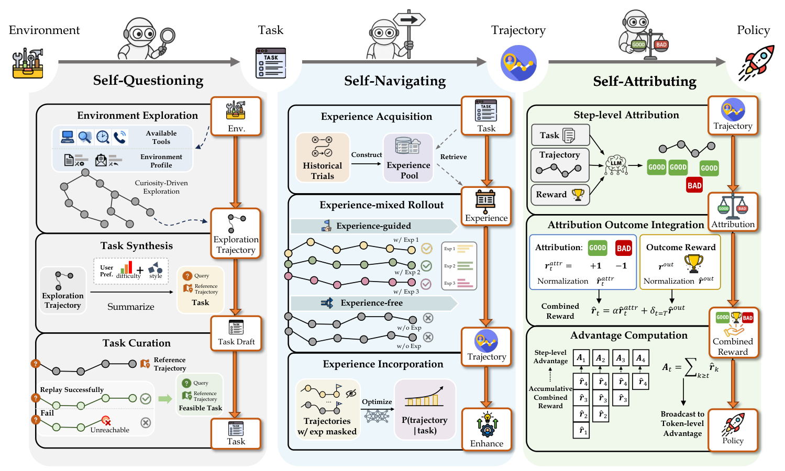

# AgentEvolver: Towards Efficient Self-Evolving Agent System

> Alibaba Group — Tongyi Lab · 2025-11-13 · paper · **闭环** · [论文](https://arxiv.org/abs/2511.10395) · [仓库](https://github.com/modelscope/AgentEvolver)
> 机制族：自博弈与课程任务生成 · 来源核验 2026-09-13 · 复现状态 not-run

## Pipeline

通过自主生成的环境任务更新智能体策略参数：自我提问生成并筛选任务，自我导航检索历史经验指导轨迹，自我归因结合结果奖励分配细粒度信用。强化学习后的策略和经验池用于后续探索。

*图源：Figure 2*
## 结果（作者报告，非本地复现）

作者表 1：Qwen2.5-7B 在 AppWorld 与 BFCL-v3 上的平均 avg@8 从 15.8% 升至 45.2%，差值为 29.4 个百分点。这是基础模型与完整训练系统的比较，并非单独归因机制的效果。

## 证据边界

闭环受任务生成、裁判质量及环境覆盖范围约束；证据针对智能体训练，不证明无限自主重构或通用 RSI。

## 对 nanoRSI 的输入

拟议 nanoRSI learner 实验：为每个策略检查点记录生成任务清单版本，并以固定数据对照组评估经验复用。

## 来源

[arXiv first submission](https://arxiv.org/abs/2511.10395) · [Paper v1: affiliation, methods, Table 1](https://arxiv.org/html/2511.10395v1) · [Official AgentEvolver repository](https://github.com/modelscope/AgentEvolver)
