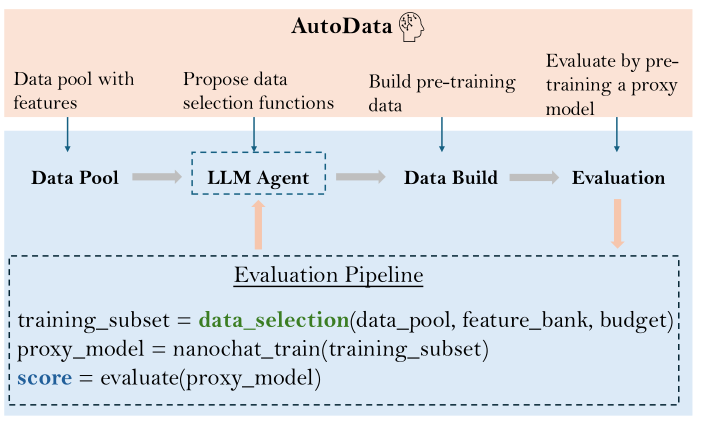

# AutoData: Agentic Search for Pre-training Data Selection

> Weco AI / University of Amsterdam · 2026-09-17 · paper · **支撑·无闭环** · [论文](https://arxiv.org/abs/2609.19754)
> 机制族：自主训练智能体与数据管线 · 来源核验 2026-09-20 · 复现状态 not-run

## Pipeline

把预训练数据选择表述为启发式工程：AIDE 式 LLM 代理在带特征标注的文档池上搜索由打分、分层与随机选择规则组成的程序空间。每个候选选集训练一个小代理模型，验证反馈（val-bpb 或下游 CORE）驱动搜索迭代，一夜完成；返回的选择算法随后无需重调即可放大到更大规模。

*图源：Figure 1 (overview.svg)*
## 结果（作者报告，非本地复现）

一夜搜索所得选择算法优于人工设计管线——DCDS、困惑度过滤、RegMix 与默认 ClimbMix 排序——在 125M 到 897M 上取得最优 val-bpb，对全部基线的改善具统计显著性，并提升下游 CORE；配方跨规模迁移无需重调。

## 证据边界

搜索在至多 897M 的代理规模上以代理目标验证；特征池依赖逐文档标注质量；核验时未找到代码。

## 对 nanoRSI 的输入

把该模式移植到技能库治理：让代理在技能库上搜索紧凑的选择器程序（打分、分层、随机保留），以小型冻结评估器为反馈，把胜出选择器留作技能库的垃圾回收器。

## 来源

[arXiv abstract](https://arxiv.org/abs/2609.19754) · [arXiv HTML v1](https://arxiv.org/html/2609.19754v1)
