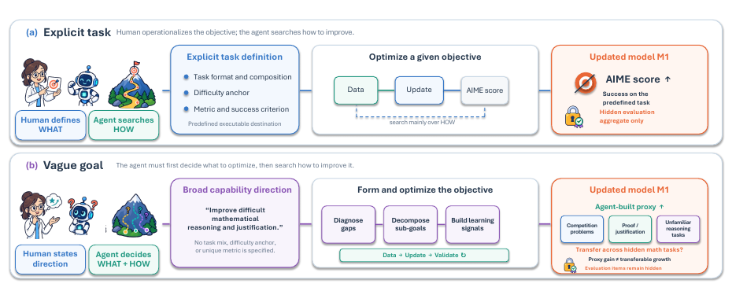

# Aspire: Can Models Self-Evolve from Vague Goals?

> ByteDance Seed / Singapore University of Technology and Design / M-A-P / TokenWave.AI · 2026-08-31 · paper · **闭环** · [论文](https://arxiv.org/abs/2608.31111)
> 机制族：自主训练智能体与数据管线 · 来源核验 2026-09-13 · 复现状态 not-run

## Pipeline

智能体根据模糊目标选择数据、训练方法及父检查点，或修改框架。控制器核验谱系并冻结候选。在评分门控的权重流程中，仅保留实测正收益且合格的检查点，否则恢复输入状态；框架在冻结后评测，不代表递归交接。

*图源：Figure 1, PDF p.2*
## 结果（作者报告，非本地复现）

隐藏评测包含六个目标下的 520 道专家题。固定 Qwen3.5-4B 为执行模型，最佳后继框架任务宏平均为 27.22，低于原始 Qwen-Agent 的 28.64；三个有效后继版本均落后于参考框架。

## 证据边界

保留收益非负可能来自回滚选择，不代表每次修改都有效；模糊目标与代理评测可能导致退化。

## 对 nanoRSI 的输入

拟议 nanoRSI learner 报告：分开记录候选原始变化与保留状态变化，导出失败尝试，并对比模糊目标与明确目标。

## 来源

[arXiv first submission](https://arxiv.org/abs/2608.31111) · [Paper v1 retention protocol and Table 1](https://arxiv.org/html/2608.31111v1) · [Official Self-Developing Agents project](https://self-developing-agents.github.io/)
