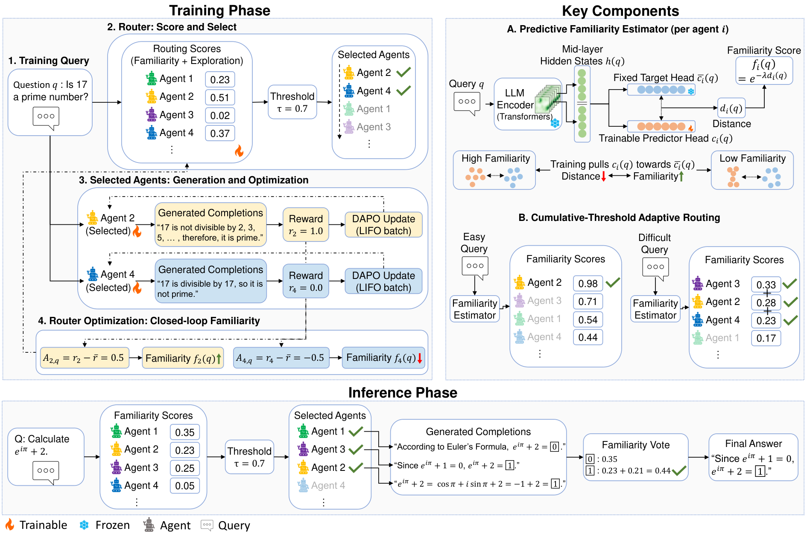

# CERA-MoA: Co-Evolving Routing Mechanisms with Continually Learning LLM Agents

> Tsinghua University (IIIS) / Shanghai Jiao Tong University / Shanghai Qi Zhi Institute · 2026-09-16 · paper · **支撑·无闭环** · [论文](https://arxiv.org/abs/2609.18779)
> 机制族：支撑性适应机制 · 来源核验 2026-09-19 · 复现状态 not-run

## Pipeline

基于中层隐藏态的预测性熟悉度估计器驱动累积阈值自适应路由，只激活持续 RL 训练的 agent 中最小胜任子集以诱导特化，路由机制本身与学习者共同演化。

*图源：Figure 1 (cera-moa.png)*
## 结果（作者报告，非本地复现）

Qwen3-4B 九个分布内基准：ID 均值 63.2，对照 AT-GRPO 61.0、RouteMoA 53.1、裸模型 49.6；OOD 均值 72.8 vs 71.5；自适应阈值把平均 token 降到 367.77（固定 top-2 为 666.37），精度相当。

## 证据边界

作者自报；相对最强基线增益约 2 点；共同演化发生在单次训练内的路由与 agent 之间，而非跨自改进代际；未找到代码发布。

## 对 nanoRSI 的输入

熟悉度估计器是 nanoRSI 技能路由的廉价信号：把任务路由到历史 rollout 看着熟悉的最小技能集，并把路由漂移记为技能过时的证据。

## 来源

[arXiv abstract](https://arxiv.org/abs/2609.18779) · [Paper HTML (in-body affiliations, Tables 2/4, Figure 1)](https://arxiv.org/html/2609.18779v1)
