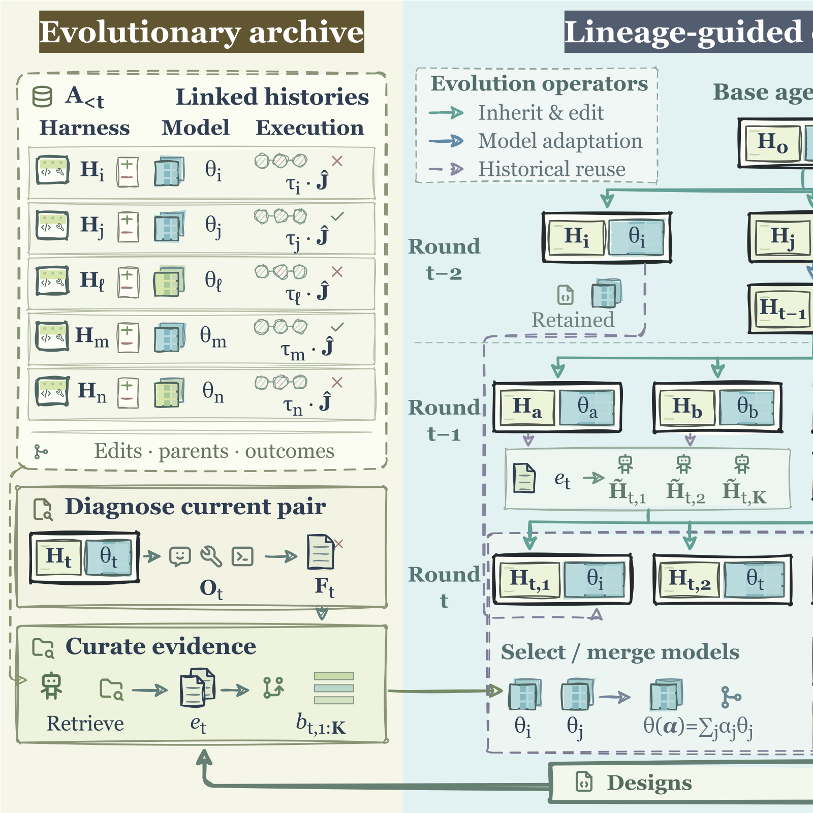

# CoEvo-RSI: When Harnesses Evolve, Which Models Should Follow?

> National University of Singapore / Agency for Science, Technology and Research (A*STAR) / SenseTime Group Inc. · 2026-10-20 · paper · **闭环** · [论文](https://arxiv.org/abs/2610.25078) · [仓库](https://github.com/SuJQ0722/CoEvo-RSI)
> 机制族：技能-权重共进化 · 来源核验 2026-10-21 · 复现状态 not-run

## Pipeline

带双向历史继承的模型-harness 协同演化。共享演化档案保存历史 harness 设计、模型检查点与结果；Curator 元智能体据此引导演化。Harness 编辑器选择历史 harness 基座，同时用检查点选择或合并提供配对模型，并在选定 harness 下适配（对自身拒绝采样轨迹做 SFT），使继承能力与演化中的执行要求对齐。每轮评估候选（harness, 模型）对，并追踪轮级接口失配率 TIMR，以检测“脑-身”失配：演化的 harness 要求模型未学会的行为、或限制模型已具备的能力。

*图源：Figure 3 (coevox-framework.svg), arXiv HTML 2610.25078v1, rendered to PNG*
## 结果（作者报告，非本地复现）

仅用自身拒绝采样轨迹的 SFT，CoEvo-RSI 使 Qwen3.5-9B 在三个垂直应用（多智能体失败归因、角色感知 text-to-SQL、智能家居指令跟随）上与更大模型竞争：在 TraceElephant 上超过 DeepSeek-V4-Pro（+14.16 agent 准确率），在 HomeBench VM 上超过 GLM-5.3（+4.90 成功率）；TraceElephant 上两个仅演化 harness 的基线 When 准确率跌破 10%，而 CoEvo-RSI 保持 28%。

## 证据边界

评估用垂直应用套件而非公开通用基准；模型侧仅 SFT 适配；TIMR 度量任务接口级失配，增益在该档案-Curator 设计下报告。

## 对 nanoRSI 的输入

每代追踪廉价的接口失配代理量（如 runner 拒绝/重试动作率），使 harness 侧编辑与轻量参数侧仅在失配上升时配对；并把种群档案保存为可重组的（编辑, 检查点）对而非线性谱系。

## 来源

[arXiv abs 2610.25078](https://arxiv.org/abs/2610.25078) · [arXiv HTML v1](https://arxiv.org/html/2610.25078v1) · [SuJQ0722/CoEvo-RSI (no license file)](https://github.com/SuJQ0722/CoEvo-RSI) · [Hugging Face collection coevo-rsi](https://huggingface.co/collections/nullptr04/coevo-rsi)
