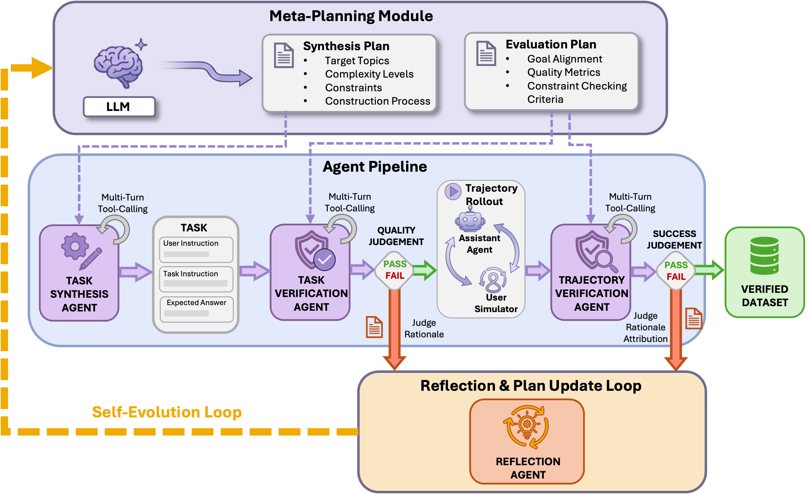

# From Self-Evolving Synthetic Data to Verifiable-Reward RL: Post-Training Multi-turn Interactive Tool-Using Agents

> Tsinghua University / Eigen AI · 2026-01-30 · paper · **闭环** · [论文](https://arxiv.org/abs/2601.22607) · [仓库](https://github.com/inclusionAI/AReaL/tree/main/examples/tau2)
> 机制族：自主训练智能体与数据管线 · 来源核验 2026-09-16 · 复现状态 not-run

## Pipeline

层级多智能体引擎生成多样化的'合成-评测'计划对；工人智能体执行任务合成、任务验证、轨迹 rollout（带用户模拟器）与轨迹验证（把失败归因到任务或轨迹）；每个实例得到一个可执行的逐实例检查器，对比最终状态与真值产生二元奖励。每次迭代由反思模块据失败更新合成与评测计划——数据管线本身在进化——随后在可验证奖励上做 GRPO 式 RL。

*图源：Figure 1*
## 结果（作者报告，非本地复现）

Qwen3-235B-A22B-2507 + RL：tau2-bench Airline 73.0% pass^1（追平 Gemini 3.0 Pro、超 GPT-5 的 62.5%），Telecom 98.3%（已报告最优）；混合训练均值 81.3% 超 Qwen3-Max-Thinking（80.7%）与 GPT-5（80.0%）。消融（Airline SFT，30B-A3B）：完整 56.0% 对无验证 50.0%、无进化 44.0%、4 组固定提示 42.5%、人类专家管线 52.0%——进化引擎胜过人工数据。

## 证据边界

Retail 仍最难（Claude Sonnet 4.5 以 86.2% 领先其 75.0%）；小模型混合训练退化（30B-A3B 均值 71.5% -> 63.7%）；现成用户模拟器在双控场景不稳。

## 对 nanoRSI 的输入

对 nanoRSI：逐实例可执行检查器 + 修订任务生成器本身的反思环——最小自进化数据环同样需要这两个面（任务有效性、轨迹归因）。

## 来源

[arXiv abstract](https://arxiv.org/abs/2601.22607) · [Paper v3 (affiliations, Figure 1, tables)](https://arxiv.org/html/2601.22607v3) · [Example code (CC BY-NC-SA 4.0)](https://github.com/inclusionAI/AReaL/tree/main/examples/tau2)
