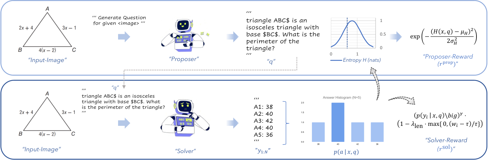

# EvoLMM: Self-Evolving Large Multimodal Models with Continuous Rewards

> Australian National University / Linkoping University / MBZUAI / Aalto University · 2025-11-20 · paper · **闭环** · [论文](https://arxiv.org/abs/2511.16672) · [仓库](https://github.com/mbzuai-oryx/EvoLMM)
> 机制族：自博弈与课程任务生成 · 来源核验 2026-09-17 · 复现状态 not-run

## Pipeline

单一冻结多模态基座拆成两个 LoRA 角色，仅用原始图像联合训练，零标注、零元数据、零奖励模型：提案者生成视觉落地的数学问题；求解者以 N=5 采样作答。求解者奖励是连续自一致性（多数答案的概率质量 + 冗长惩罚——不确定时仍有非零梯度）；提案者奖励是求解者答案熵的高斯带通（峰在中等难度），形成自动课程。KL 正则 REINFORCE + EMA 基线；总共约 6K 张原始图像。

*图源：Figure 2*
## 结果（作者报告，非本地复现）

Qwen2.5-VL-7B：ChartQA 84.00 -> 86.70、MathVista 68.46 -> 70.52、MathVision 23.91 -> 24.81；72B：ChartQA 88.20 -> 91.04、MathVista 73.93 -> 76.44。增益真实但温和，且论文记录了'过度共识塌缩'——N 大时（N=12）求解者退化为确定性作答。

## 证据边界

提案者问题偶有歧义；感知瓶颈（细线、小网格、密集图例）；对图表风格模板的风格过拟合；大采样数下过度共识塌缩。

## 对 nanoRSI 的输入

对 nanoRSI：连续自一致性奖励（不确定时仍有非零梯度）与熵带通课程可直接移植到任何自博弈任务生成器；N 塌缩失败模式应写入环的停止条件。

## 来源

[arXiv abstract](https://arxiv.org/abs/2511.16672) · [Paper v4 (affiliations, Figure 2, table)](https://arxiv.org/html/2511.16672v4) · [Code repository](https://github.com/mbzuai-oryx/EvoLMM)
