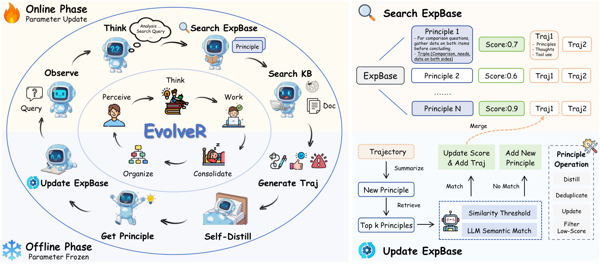

# EvolveR: Self-Evolving LLM Agents through an Experience-Driven Lifecycle

> Shanghai AI Laboratory / Zhejiang University / East China Normal University / Fudan University / Shanghai Jiao Tong University 等 · 2025-10-17 · paper · **闭环** · [论文](https://arxiv.org/abs/2510.16079)
> 机制族：经验蒸馏与测试时适应 · 来源核验 2026-09-16 · 复现状态 not-run

## Pipeline

闭环经验生命周期，两阶段交替：离线阶段参数冻结，智能体以专家人设回顾历史轨迹，蒸馏成'指导性'（成功）与'警示性'（失败）原则——自然语言描述 + 知识三元组，经嵌入相似度与 LLM 等价性双重去重、按动态有用性分数剪枝；在线阶段检索到的原则参与推理，轨迹再喂给下一轮蒸馏；GRPO 更新策略，使其学会使用自己蒸馏的智慧。

*图源：Figure 2*
## 结果（作者报告，非本地复现）

Qwen2.5-3B 搜索智能体均值 0.382 对 Search-R1-instruct 0.325、拒绝采样 0.265、RAG 0.270；Qwen2.5-7B 均值 0.417 对 0.385。消融（3B）：去经验检索 0.340；仅 RL 0.325；外师蒸馏（GPT-4o-mini）0.370 对自蒸馏 0.382——自蒸馏胜过外部教师。

## 证据边界

自蒸馏质量受基座能力上界约束；仅在 QA 上验证（具身/创意未测）；终身算力效率未解；自进化策略的安全性依赖奖励函数。

## 对 nanoRSI 的输入

对 nanoRSI：参数冻结的离线蒸馏阶段可直接移植——把被接受的轨迹变成去重原则卡，并用动态有用性分数剪除死条目。

## 来源

[arXiv abstract](https://arxiv.org/abs/2510.16079) · [Paper v3 (affiliations, Figure 2, tables)](https://arxiv.org/html/2510.16079v3)
