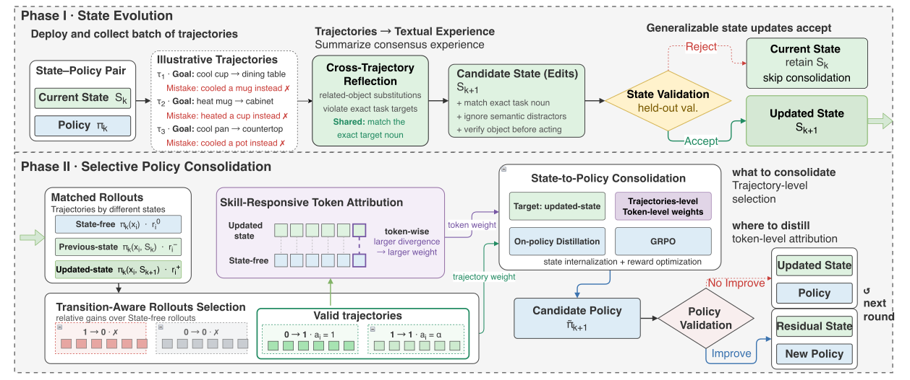

# Experience Funnel: A State-Policy Alternating Loop for Self-Evolving Agents

> The Hong Kong Polytechnic University / Huawei / Renmin University of China · 2026-09-08 · paper · **闭环** · [论文](https://arxiv.org/abs/2609.08919)
> 机制族：经验蒸馏与测试时适应 · 来源核验 2026-09-16 · 复现状态 not-run

## Pipeline

对已部署的（文本状态、策略）对做双时间尺度循环。快：把轨迹聚合成总结复现流程、失败模式与纠偏策略的任务级文本状态，候选状态编辑必须先在留出交互上通过验证。慢：转换感知技能蒸馏在无状态、旧状态、新状态三种条件下对比 rollout，把每条经验标注为新有用 (0,1)、持续有用 (1,1)、退化 (1,0)、失活 (0,0)；token 级 Jensen-Shannon 散度定位状态敏感决策，状态条件化教师只把有用 rollout 蒸馏进无状态学生策略，并叠加无状态 RL 奖励。更新后的对重新部署进入下一轮。

*图源：Figure 1*
## 结果（作者报告，非本地复现）

三个基准（SearchQA、ALFWorld、WebShop），Qwen3.5-4B 学生、冻结 Qwen3.5-27B 教师，昇腾 910B3：平均 57.6% 对 SkillRL 56.2、OPID 55.4、SkillOpt 53.9、基座 33.7。无状态策略本身在 SearchQA 五轮内 58.1% -> 61.3%（巩固后残余状态无增益：全状态 61.3 = 残余状态 61.3）。消融：仅状态 61.1、仅策略 62.8、完整环 63.6；经验选择 (0,1)+(1,1) 达 63.0 对未过滤 58.9。诚实空转记录：五轮进化只有第 1、4 轮被接受，第 2、3、5 轮被拒绝。

## 证据边界

无代码发布；对 SkillRL 的领先仅 +1.4 分；分基准数字显示增量主要来自 SearchQA（WebShop 42.4 仍低）。被拒绝的轮次如实报告但未深入分析。

## 对 nanoRSI 的输入

对 nanoRSI 参数轨：用反事实状态对比（无状态 / 旧状态 / 新状态三种 rollout）作为上下文变更是否值得蒸馏的验收测试，让权重更新像技能提交一样过闸门。

## 来源

[arXiv abstract](https://arxiv.org/abs/2609.08919) · [Paper v1 (affiliations, Figure 1, Tables, ablations)](https://arxiv.org/html/2609.08919v1)
