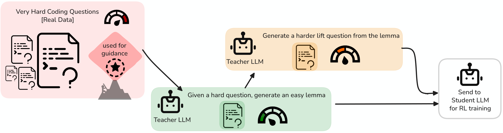

# GASP: Guided Asymmetric Self-Play For Coding LLMs

> University of Tübingen / Max Planck Institute for Intelligent Systems / ELLIS Institute Tübingen / Tübingen AI Center · 2026-03-16 · paper · **闭环** · [论文](https://arxiv.org/abs/2603.15957)
> 机制族：自博弈与课程任务生成 · 来源核验 2026-09-19 · 复现状态 not-run

## Pipeline

锚定真实难题的非对称自博弈：对标准 RLVR 解不出的 goalpost 题，教师先生成较易的 lemma 变体、再生成更难的 lift 变体构成课程；学生解答经拒绝采样回炉训练，全程无需外部数据。

*图源：Figure 1 (overview_fig.png)*
## 结果（作者报告，非本地复现）

Qwen2.5-Coder-7B 在 LiveCodeBench v5（216 题、3 种子）：pass@20 33.69±0.28，对照 AZR 31.15、真实数据 RL 33.10、底座 29.68；GASP+真实数据 RL 最佳 34.46；pass@1 18.26 vs AZR 17.49。pass@100 解出 146 道 goalpost 中的 11 道（基线按构造为 0）；HumanEval+ 上 AZR 仍胜（83.54 vs 79.67）。

## 证据边界

增益在单一编码基准族上绝对点数不大；HumanEval+ 的退化论文如实报告；未找到代码发布。

## 对 nanoRSI 的输入

goalpost 机制可映射到 nanoRSI 探针任务：维护未解冻结任务清单，让提案者朝它们生成 lemma/lift 变体，把攻破的 goalpost 数作为搜索进度读数。

## 来源

[arXiv abstract](https://arxiv.org/abs/2603.15957) · [Paper HTML (affiliations, Table 1, Figure 1)](https://arxiv.org/html/2603.15957v1)
