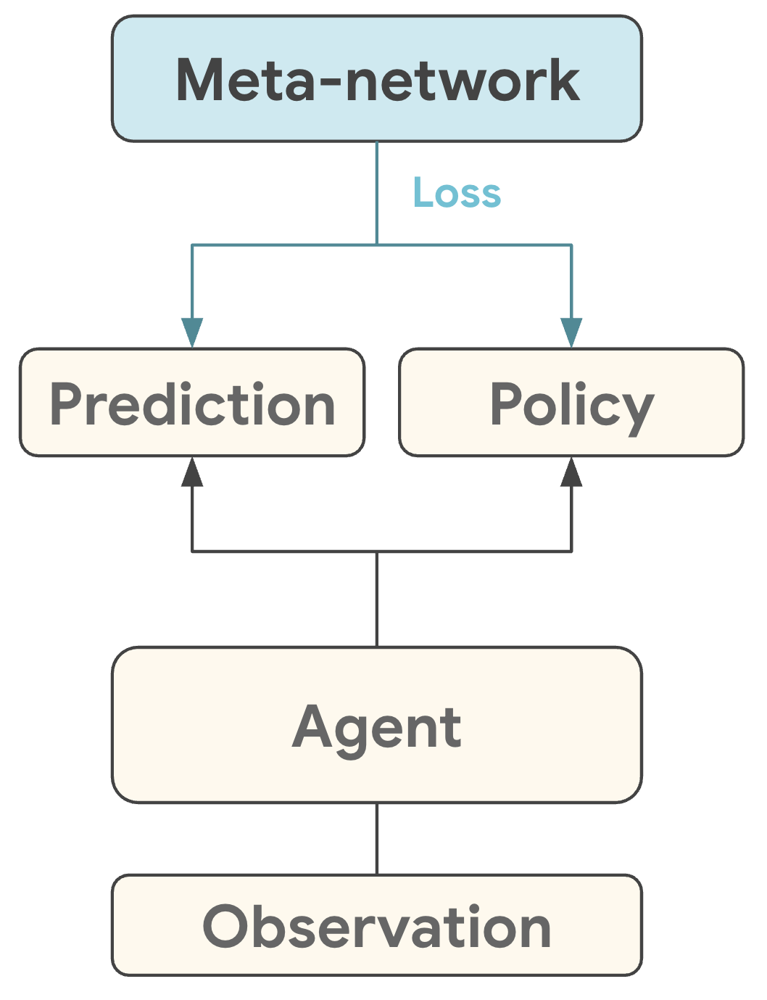

# Discovering state-of-the-art reinforcement learning algorithms

> Google DeepMind · 2025-10-22 · paper · **支撑·无闭环** · [论文](https://pmc.ncbi.nlm.nih.gov/articles/PMC12695655/) · [仓库](https://github.com/google-deepmind/disco_rl)
> 机制族：支撑性适应机制 · 来源核验 2026-09-13 · 复现状态 not-run

## Pipeline

元网络提供策略和预测的更新目标；元梯度优化智能体总体回报，更新后的规则用于后续智能体；发现的规则冻结后迁移到新环境。

*图源：Official project method figure*
## 结果（作者报告，非本地复现）

扩展数据图4报告：在57个Atari游戏、2亿环境步的比较下，以约少40%的评价阶段TPU计算达到MuZero最终表现；该数字不包含额外的算法发现成本。

## 证据边界

人类设计的元目标和框架固定，证据限于学习规则发现，不能证明通用智能递归修改自身。

## 对 nanoRSI 的输入

建议实验：区分学习器权重与更新规则参数，先在小型环境中验证外层目标，再扩大规模。

## 来源

[Primary Nature article at PMC](https://pmc.ncbi.nlm.nih.gov/articles/PMC12695655/) · [Publication metadata](https://pubmed.ncbi.nlm.nih.gov/41125136/) · [Author project and artifact availability](https://google-deepmind.github.io/disco_rl/) · [Official code and licence statements](https://github.com/google-deepmind/disco_rl)
