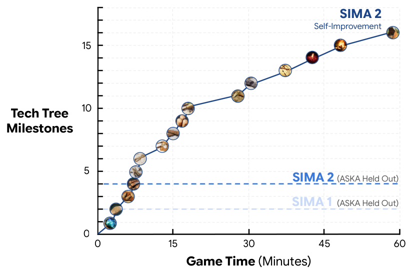

# SIMA 2: A Generalist Embodied Agent for Virtual Worlds

> Google DeepMind · 2025-11-13 · report · **闭环** · [论文](https://arxiv.org/abs/2512.04797)
> 机制族：自博弈与课程任务生成 · 来源核验 2026-09-13 · 复现状态 not-run

## Pipeline

Gemini生成任务并评价轨迹；积累的经验用于训练后续SIMA世代，新策略继续采集经验。初始智能体由人类示范启动。

*图源：Figure 16*
## 结果（作者报告，非本地复现）

在固定ASKA任务中，初始不足四分之一的任务超过Gemini奖励阈值（>50），后续世代全部超过阈值。这是模型评分下的任务覆盖率，不能当作独立验证的回合成功率；该组固定任务来自人类。

## 证据边界

证据限于游戏实验、模型评价器和较短记忆；未展示Gemini或学习算法本身的改进。

## 对 nanoRSI 的输入

建议实验：分别记录学习器世代和评分轨迹，并用独立保留任务集验证迁移。

## 来源

[Google DeepMind announcement](https://deepmind.google/blog/sima-2-an-agent-that-plays-reasons-and-learns-with-you-in-virtual-3d-worlds/) · [Paper version history](https://arxiv.org/abs/2512.04797) · [Paper v1, section 4.5](https://arxiv.org/html/2512.04797v1)
