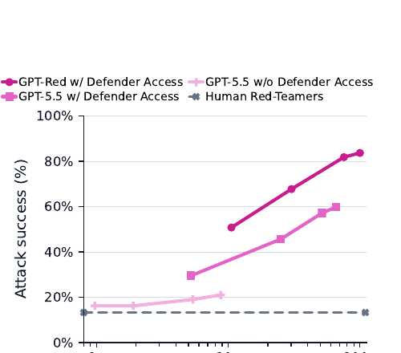

# GPT-Red: Automated Red Teaming via Self-Play at Scale

> OpenAI · 2026-07-15 · paper · **闭环** · [论文](https://cdn.openai.com/pdf/gpt-red-automated-red-teaming-via-self-play-at-scale.pdf)
> 机制族：自博弈与课程任务生成 · 来源核验 2026-09-13 · 复现状态 not-run

## Pipeline

自博弈 RL 依据攻击成功与抵抗成功的奖励更新攻击者和防守模型群体；更强防守者提供更难训练信号，再用训练后的红队生成 GPT-5.6 的对抗训练数据。

*图源：Figure 1, PDF p.1*
## 结果（作者报告，非本地复现）

报告中，GPT-5.6 Sol 面对 GPT-Red 直接注入的成功攻击率为 0.05%，按保留环境内的攻击尝试取平均；不能解释为任意攻击都只有这一成功概率。

## 证据边界

属于有界对抗共同训练，未证明自主设计下一代模型；内部模型及训练规模限制本地复现。

## 对 nanoRSI 的输入

可探索无害对抗样例，并分别衡量样例有效性、任务完成率和误拒率。

## 来源

[Paper](https://cdn.openai.com/pdf/gpt-red-automated-red-teaming-via-self-play-at-scale.pdf) · [Official report](https://openai.com/index/unlocking-self-improvement-gpt-red/)
