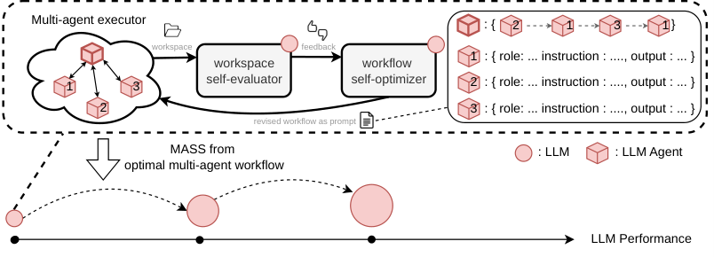

# Recursive Self-Improvement through Multi-Agent Self-Supervision

> UC Berkeley / Sakana AI · 2026-10-08 · paper · **闭环** · [论文](https://arxiv.org/abs/2610.12176) · [仓库](https://github.com/SakanaAI/mass)
> 机制族：经验蒸馏与测试时适应 · 来源核验 2026-10-13 · 复现状态 not-run

## Pipeline

MASS 交替两个阶段：第一阶段冻结权重，用 RHI 搜索演化多智能体工作流拓扑（角色、信息路由与结构护栏），并将其编码为文本化 workflow 提示，同一个语言模型在内环中同时担任执行器、自评估器与自优化器；第二阶段用选出的多智能体工作流产生的自生成轨迹微调模型，更新后的模型进入下一周期继续担任执行器/优化器/评估器，构成同源自监督下的递归自举。

*图源：Figure 1 (ICLRpaper_new11.png): inner loop of agent/evaluator/optimizer sharing one LM and the outer cycle of workflow search plus post-training*
## 结果（作者报告，非本地复现）

作者报告的结果：以 Qwen3.6-27B 为起点、qwen-code 0.20.0 脚手架、两轮 MASS 周期后，MLR-Bench、DSBench、ScienceAgentBench 与 AstaBench 上单位输出 token 得分为基座的 1.2-1.6 倍；在三个留出测试任务上对外部裁判的胜率从第一周期的 53.9% 升至第二周期的 69.9%；原始分数在 MLR-Bench（1.71 到 2.25）、ScienceAgentBench（28.8% 到 31.7%）、AstaBench 交付率（50% 到 76%）上提升，DSBench 基本持平（0.473 到 0.482），Terminal-Bench 2.0（0.375 到 0.352）与 SWE-bench Verified（0.626 到 0.611）下降。多智能体轨迹训练的学生超过用 1.4 倍 token 训练的单智能体学生，评估器与外部裁判的一致率从 73% 升至 93%。

## 证据边界

增益集中在开放式研究型基准上，Terminal-Bench 与 SWE-bench 的迁移为负（作者同样如实报告）；同源自监督使执行器/评估器/优化器共享同一模型的盲区，论文自身也提示了自评估循环的安全问题。结果依赖后训练基础设施（LoRA 微调），且为作者在其模型、任务与算力条件下的报告，不是 nanoRSI 复现。

## 对 nanoRSI 的输入

两个可移植思路，不引入任何 MASS 代码或训练栈：(1) 在 skills/harness 轨道测试多角色自监督脚手架——同一模型以执行器/评估器/优化器三种提示作用于同一工作区——在匹配调用、token 与种子下与单智能体脚手架对照；(2) 其 terminal/SWE 套件上的负迁移提示保持按域分离的留出面板，避免把开放式任务上的工作流增益过度外推。两者都符合现有受控对照协议；本轮不改变 nanoRSI 默认行为。

## 来源

[arXiv abstract](https://arxiv.org/abs/2610.12176) · [arXiv HTML v1 and Figure 1](https://arxiv.org/html/2610.12176v1) · [Official MASS project page](https://pub.sakana.ai/mass/) · [Official research implementation](https://github.com/SakanaAI/mass) · [Repository NOTICE on licensing](https://github.com/SakanaAI/mass/blob/main/NOTICE.md) · [Sakana AI MASS post](https://sakana.ai/mass/)
