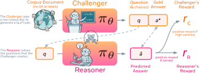

# SPICE: Self-Play In Corpus Environments Improves Reasoning

> Meta FAIR / National University of Singapore · 2025-10-28 · paper · **闭环** · [论文](https://arxiv.org/abs/2510.24684)
> 机制族：自博弈与课程任务生成 · 来源核验 2026-09-21 · 复现状态 not-run

## Pipeline

单一 RL 模型在原始语料上扮演两角：挑战者从文档挖出（问题，可验证答案）对；推理者不看文档作答（信息不对称）。挑战者获得峰在推理者 50% 通过率的高斯方差奖励——正好落在推理者能力前沿的自动课程——推理者拿二元正确性奖励。双角色共享权重、经 DrGRPO（角色专属均值中心优势）联合训练；无效任务给小额负罚。

*图源：Figure 2*
## 结果（作者报告，非本地复现）

Qwen3-4B-Base：35.8% -> 44.9%（+9.1）；Qwen3-8B-Base +5.7；OctoThinker-3B/8B +10.5/+11.9——摘要口径跨家族数学 +8.9%、通用推理 +9.8%。Qwen3-4B 上胜 Strong Challenger（+7.2）、R-Zero（+3.7）、Absolute Zero（+4.9）。训练动态：挑战者变强时固定推理者通过率从 55% 降到 35%；语料落地加 +3.2。

## 证据边界

语料仅 2 万文档（每篇复用约 2-3 次）；验证依赖可从文档抽取的答案类型；R-Zero 基线因退化只训了 5 轮，可能影响基线公平性。

## 对 nanoRSI 的输入

对 nanoRSI：用执行者的成功率方差（峰值 50%）而非原始难度奖励任务生成器——一行改动即可让生成任务始终落在当前候选可学习的边界上。

## 来源

[arXiv abstract](https://arxiv.org/abs/2510.24684) · [Paper v1 (affiliations, Figure 2, tables)](https://arxiv.org/html/2510.24684v1)
