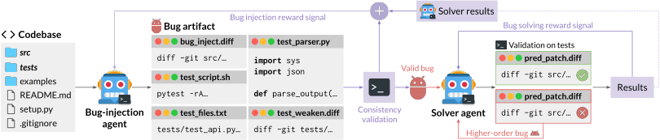

# Toward Training Superintelligent Software Agents through Self-Play SWE-RL

> Meta FAIR / University of Illinois Urbana-Champaign / Carnegie Mellon University · 2025-12-21 · paper · **闭环** · [论文](https://arxiv.org/abs/2512.18552)
> 机制族：自博弈与课程任务生成 · 来源核验 2026-09-16 · 复现状态 not-run

## Pipeline

单个 LLM（CWM-sft 32B）在沙箱化的真实仓库上同时扮演缺陷注入者与修复者，无需人工 issue 或测试。注入者在不看测试与 issue 的情况下探索仓库、发现测试运行方式，产出缺陷工件（测试脚本、解析器、注入 diff、测试弱化 diff），经一致性检查（含逆变异测试）验证；修复者只看反转的弱化补丁作为形式规格，必须给出通过恢复后 oracle 测试的修复。失败的求解尝试转化为有上限的二阶'高阶缺陷'。奖励完全锚定在测试结果上。

*图源：Figure 1*
## 结果（作者报告，非本地复现）

自博弈 RL 后（CWM-sft 32B、512 张 H100）SWE-bench Verified +10.4 分、SWE-Bench Pro +7.8 分；整条训练轨迹上持续优于人类数据基线，并迁移到自博弈中从未见过的自然语言 issue。论文自述 SWE-bench Verified 配对标准误约 2%。

## 证据边界

作者自述缺少隐藏 oracle（完整测试进提示会诱发奖励黑客）、只用单元测试验证、双角色共享同一模型配置、合成自然语言 issue 会退化成无意义模式。附录 A 记录了挑战者的主导策略会使无缓解的自博弈停滞。

## 对 nanoRSI 的输入

对 nanoRSI：让变异者同时产出验证器工件（测试脚本 + 弱化补丁）并用逆变异测试校验的自博弈任务生成——无人工标注下生成器-验证器协同生产的蓝图。

## 来源

[arXiv abstract](https://arxiv.org/abs/2512.18552) · [Paper v3 (affiliations, Figure 1, ablations, Appendix A)](https://arxiv.org/html/2512.18552v3)
