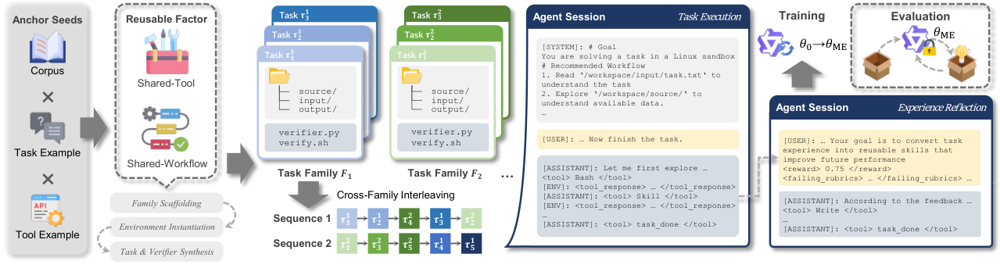

# MetaExp: Learning to Self-Improve through Experience via Verifiable Cross-Task Environment Scaling

> University of Macau / Shenzhen Institute of Advanced Technology, Chinese Academy of Sciences / Georgia Institute of Technology / Alibaba Group · 2026-10-15 · paper · **闭环** · [论文](https://arxiv.org/abs/2610.21492)
> 机制族：经验蒸馏与测试时适应 · 来源核验 2026-10-19 · 复现状态 not-run

## Pipeline

把经验学习本身训练为可迁移的模型能力。环境被扩展为具有可控跨任务结构的可验证任务族：Shared-Tool 族跨任务固定黑盒工具（诱导操作型经验），Shared-Workflow 族在变化的任务实现中保持潜层流程（诱导流程型经验）。收集并过滤顺序交互与反馈驱动的反思轨迹，在来自 1,000 个任务族的 4,956 条轨迹上微调 Qwen3.5-122B-A10B。部署时参数冻结，经验在未见任务分布上从空库累积。

*图源：Figure 1 (framework.png), arXiv HTML 2610.21492v1 (section 3)*
## 结果（作者报告，非本地复现）

下游演化期参数冻结：SpreadsheetBench +8.5 分、APEX-Agents 峰值 +2.3、AutomationBench +14.8（对匹配基座）；域排除训练（剔除被评测域的任务族）下增益保持，并延伸到外部供给的技能；在异质保留基准上，受训模型从累积经验中获得的收益持续高于其匹配基座。

## 证据边界

仅单一受训基座（Qwen3.5-122B-A10B）；APEX-Agents 增益峰值 +2.3，为三个基准中最小；下游评测一律从空经验库开始，未测跨部署保留经验的收益；训练依赖两种设计的族结构，其对真实任务跨结构的覆盖未量化。

## 对 nanoRSI 的输入

族结构任务切分是 nanoRSI 变体/反事实面板的设计规则：把训练任务组织成共享固定工具或潜层流程而任务实现变化的族，使被接受的技能必须跨族泛化而非记忆实例——直接加强 cf-source-* 反事实设计与未来的技能迁移度量。

## 来源

[arXiv abs 2610.21492](https://arxiv.org/abs/2610.21492) · [arXiv HTML v1](https://arxiv.org/html/2610.21492v1)
