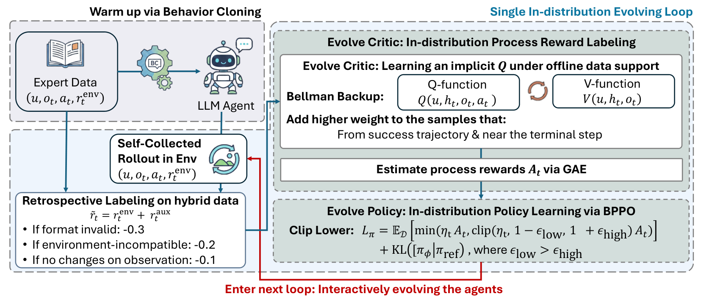

# Self-Evolving LLM Agents with In-Distribution Optimization

> Eindhoven University of Technology / University of Liverpool / MIT-IBM Watson AI Lab · 2026-06-05 · paper · **闭环** · [论文](https://arxiv.org/abs/2606.07367)
> 机制族：经验蒸馏与测试时适应 · 来源核验 2026-09-16 · 复现状态 not-run

## Pipeline

每轮自进化在专家演示与自身轨迹的混合集上用加权隐式 Q-Learning 训练分布内评论家（不对分布外动作取 max；步权上调成功轨迹中信息量大的后段步骤），仅在环境奖励上做 GAE 得到步骤级过程奖励，再用行为近端策略优化——非对称裁剪激进压制负优势动作——显式控制跨轮分布漂移。策略、评论家与数据集在 2-3 轮迭代中共进化。

*图源：Figure 2*
## 结果（作者报告，非本地复现）

Llama-2-7B-Chat 骨干：均值 79.4 对 QLASS 74.5、ETO 69.4、Best-of-N 65.4、PPO 45.3（ALFWorld seen/unseen 90.7/89.6；ScienceWorld unseen 69.7；WebShop 70.5）。样本效率：ALFWorld（Qwen2.5-7B）仅 13K 环境步达 88.6/87.3，对 PPO/RLOO/GRPO 的 320K 与 QLASS 的约 600K。

## 证据边界

回溯奖励依赖结构化环境反馈；贪婪 rollout 降低跨轮轨迹多样性；跨轮分布漂移未显式纠正。

## 对 nanoRSI 的输入

对 nanoRSI 模型轨：每轮学习都用当前策略自身 rollout（加演示）训练分布内评论家，并用非对称裁剪——多轮稳定、无离策略漂移的配方。

## 来源

[arXiv abstract](https://arxiv.org/abs/2606.07367) · [Paper v1 (affiliations, Figure 2, Tables 2/5/6)](https://arxiv.org/html/2606.07367v1)
