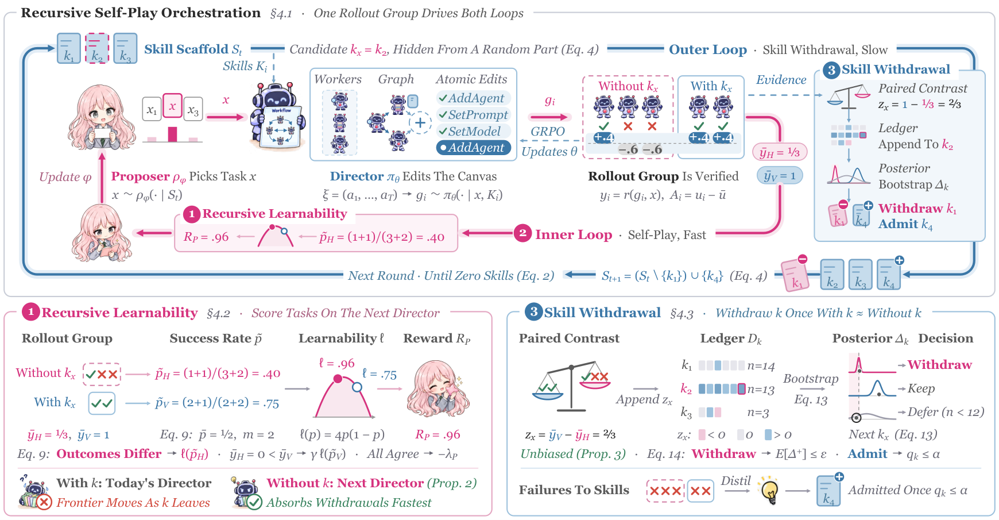

# R$^2$Orch: Recursive Self-Improvement for Agent Orchestration via Self-Play within a Skill-Internalization Loop

> The Chinese University of Hong Kong, Shenzhen / Fudan University / University of Illinois Urbana-Champaign / Tsinghua University / National University of Singapore · 2026-10-19 · paper · **闭环** · [论文](https://arxiv.org/abs/2610.22740) · [仓库](https://anonymous.4open.science/r/R2Orch-36F1)
> 机制族：自博弈与课程任务生成 · 来源核验 2026-10-20 · 复现状态 not-run

## Pipeline

在冻结 Worker 池上的两层嵌套环。内环：Proposer-Director 在随机化 rollout 组上自博弈——Proposer 选任务，Director 编排 Workers 执行。外环：技能撤除——失败蒸馏成技能、技能经训练内化进 Director、随后撤除，使编排器走向零技能部署。递归可学性是训练目标：奖励 Proposer 选择“随技能撤除 rollout 结果持续分化”的任务，取代手工课程，缓解优势塌缩与单噪声评分。

*图源：Figure 3 (R2Orch-Figure3.png), arXiv HTML 2610.22740v1*
## 结果（作者报告，非本地复现）

横跨问答、数学、代码与交互任务的十二个基准（含 AIME 2026、ALFWorld、WebShop；128 题测试集与训练不相交）：在每个基准上都超过全部基线（五次重复均值带标准差；基线含均匀采样、DAPO、SFL 可学性、Absolute Zero 求解率与 R-Zero 不确定性等提案目标）；零技能测试时精度保留；用 Qwen3.5-9B Workers 训练的 Director 不经再训练即改进六个其他 Worker 骨干，将 IID 分差从 25.7 收窄到 6.4 个点。

## 证据边界

仅编排器侧学习（编排训练期间 Workers 冻结）；改进在公开基准上以 0/1 指标度量；理论依赖随机化 rollout 组结构；匿名仓库内容无法用普通抓取核验。

## 对 nanoRSI 的输入

把技能撤除当闸门信号：周期性地在移除技能文件的上下文里重评 nanoRSI 已接受技能；只晋升或保留那些零技能评估下仍有增益的编辑，让“上下文拐杖”型编辑像 counterfactual 面板暴露 shortcut 编辑一样显形。

## 来源

[arXiv abs 2610.22740](https://arxiv.org/abs/2610.22740) · [arXiv HTML v1](https://arxiv.org/html/2610.22740v1) · [Anonymous code (JS-only)](https://anonymous.4open.science/r/R2Orch-36F1)
