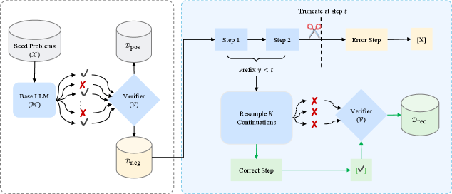

# Reflective Recovery: A Self-Supervised Method for Reasoning by Learning from Mistakes

> Zhejiang University / The University of Hong Kong / The Hong Kong University of Science and Technology · 2026-09-18 · paper · **闭环** · [论文](https://arxiv.org/abs/2609.19156)
> 机制族：经验蒸馏与测试时适应 · 来源核验 2026-09-20 · 复现状态 not-run

## Pipeline

把失败推理轨迹转化为恢复训练数据：失败尝试的初始片段与提示配对，用于引导模型走向正确解。因片段含错误，模型无需外部评论家或奖励模型即可学会检测并修复错误——针对模仿学习的规模塌缩：问题集有限时增加完美样本不再带来提升。

*图源：Figure 1 (x1.png)*
## 结果（作者报告，非本地复现）

在 DeepSeek-R1-Distill-Qwen-7B 上，AIME 2025 准确率从 30.0% 升至 37.5%，Minerva 从 37.6% 升至 47.8%（对照为未使用该方法的同一基模型）；论文称这打破了规模塌缩屏障并产生涌现式自我纠错行为。

## 证据边界

摘要级数字仅报告单一 7B 主干家族；未找到代码；九月才公开、社区审视尚新；所引结果仅在数学推理基准上测得。

## 对 nanoRSI 的输入

把 nanoRSI 的被拒候选档案回灌为训练式信号：将每个被拒提案的失败前缀与最终被接受的修复配对，使提案策略从自身错误学恢复，无需新标注。

## 来源

[arXiv abstract](https://arxiv.org/abs/2609.19156) · [arXiv HTML v1](https://arxiv.org/html/2609.19156v1)
