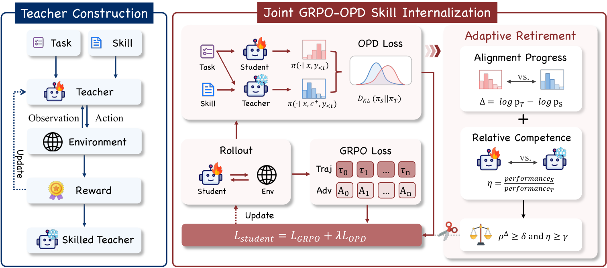

# RetireOPD: Self-Retiring On-Policy Distillation for Agentic Reinforcement Learning

> Zhejiang University / Alibaba Group · 2026-09-17 · paper · **支撑·无闭环** · [论文](https://arxiv.org/abs/2609.20784) · [仓库](https://github.com/ZJU-REAL/SDAR)
> 机制族：经验蒸馏与测试时适应 · 来源核验 2026-09-19 · 复现状态 not-run

## Pipeline

先用环境奖励训练技能条件教师；无技能学生通过 RL 加在线策略技能蒸馏联合学习；师生差异收敛后教师自动退役、训练继续纯 RL——技能最终内化进权重。

*图源：Figure 3 (method.png)*
## 结果（作者报告，非本地复现）

Qwen2.5 1.5B-7B 全档：ALFWorld 成功率较 RL（GRPO）基线 +14.1%~+18.8%、WebShop 准确率 +11.8%~+19.0%；学生仅在每档设置都超过自己的技能条件教师。

## 证据边界

作者自报于 ALFWorld/WebShop；退役判据是散度启发式，非平稳任务上可能提前触发；本质是技能到权重的内化支撑而非自改进闭环。

## 对 nanoRSI 的输入

退役是 ADOPTION 26 缺的生命周期另一半：给巩固后的技能工件一个自动过期测试（冻结策略是否仍胜过无工件策略？），内化完成即退役。

## 来源

[arXiv abstract](https://arxiv.org/abs/2609.20784) · [Paper HTML (affiliations, Figure 3, results)](https://arxiv.org/html/2609.20784v1) · [Code repository](https://github.com/ZJU-REAL/SDAR)
