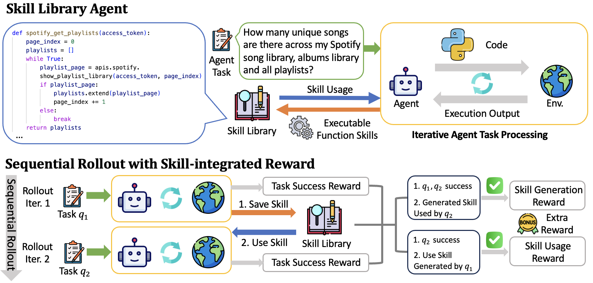

# Reinforcement Learning for Self-Improving Agent with Skill Library

> AWS Agentic AI (Amazon) / University of Wisconsin-Madison · 2025-12-18 · paper · **闭环** · [论文](https://arxiv.org/abs/2512.17102) · [仓库](https://github.com/amazon-science/SAGE)
> 机制族：技能-权重共进化 · 来源核验 2026-09-21 · 复现状态 not-run

## Pipeline

技能增强 GRPO：智能体定义并调用函数式技能（CodeAct 风格，沿用 DynaSaur），顺序 rollout 让同一智能体跨相似任务链执行，任务一生成的技能在任务二被复用——后续技能使用的成功奖励把信用回传给更早的技能生成。技能整合奖励为'生成的技能被成功复用'与'成功使用检索到的技能'加成。GRPO 改为用奖励均值优势（无 std 归一化、无 KL 惩罚），跨任务链、按任务技能库计算。

*图源：Figure 1*
## 结果（作者报告，非本地复现）

AppWorld（Qwen2.5-32B-Instruct）：对基线 GRPO，Scenario Goal Completion +8.9%、交互步数少 26%、token 少 59%（Test Normal 60.7% 对 51.8% SGC，1,475 对 3,613 token；Test Challenge 32.4% 对 26.9%）。胜 LOOP（53.6% SGC）与 GPT-4o ReAct（32.1%）；链长消融显示 3 任务链（54.8% SGC）不如 2 任务链。

## 证据边界

实验仅在 AppWorld 上进行；作者自述不同场景可能需要不同智能体设计。

## 对 nanoRSI 的输入

对 nanoRSI：在相关任务链上而非孤立回合评估技能，并把奖励信用回传给生成技能的步骤——直接回答'生成的技能如何被选择'。

## 来源

[arXiv abstract](https://arxiv.org/abs/2512.17102) · [Paper v1 (affiliations, Figure 1, tables)](https://arxiv.org/html/2512.17102v1) · [Artifact repository](https://github.com/amazon-science/SAGE)
