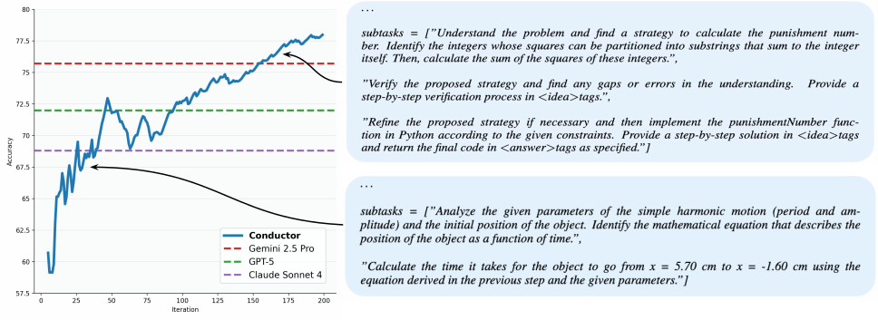

# Learning to Orchestrate Agents in Natural Language with the Conductor

> Sakana AI / University of Michigan / Institute of Science Tokyo · 2025-12-04 · paper · **支撑·无闭环** · [论文](https://arxiv.org/abs/2512.04388)
> 机制族：支撑性适应机制 · 来源核验 2026-09-21 · 复现状态 not-run

## Pipeline

一个 7B 模型（Qwen2.5-7B）经 200 轮 GRPO 训练，以三张 Python 列表输出完整协调策略——工人模型 ID、自然语言子任务指令、访问列表——从而学会在更强的工人之间设计通信拓扑并为其提示工程，以随机化智能体池上的任务奖励端到端训练。由于 Conductor 可以把自己也指定为工人，发现的拓扑可递归嵌套，实现动态测试时扩展。

*图源：Figure 3*
## 结果（作者报告，非本地复现）

Conductor（7B 协调 GPT-5/Claude/Gemini 级工人）：LiveCodeBench 83.93、GPQA-D 87.5、AIME25 93.3、均值 77.27——高于 GPT-5（74.78）与任一单工人；受限设定下对多智能体基线：MASRouter 56.89、MoA 62.13、RouterDC 52.41、Smoothie 56.48 对 Conductor 均值 72.35。

## 证据边界

依赖昂贵的前沿工人（作者自述加剧数字鸿沟的担忧）；细粒度拓扑变体无显著收益；7B 协调器限制规划质量。Fugu 数字来自厂商自家的技术报告。

## 对 nanoRSI 的输入

对 nanoRSI：'协调即习得技能'——若存在候选 harness 种群，一个训练出的小型选择器（可把自身纳入编排）是可与规则选择对照的廉价种群级元控制器。

## 来源

[Conductor arXiv abstract](https://arxiv.org/abs/2512.04388) · [Paper v5 (affiliations, training figure, Tables 1/7)](https://arxiv.org/html/2512.04388v5) · [Fugu product page](https://sakana.ai/fugu/) · [Fugu Max release post](https://sakana.ai/fugu-max-release/)
