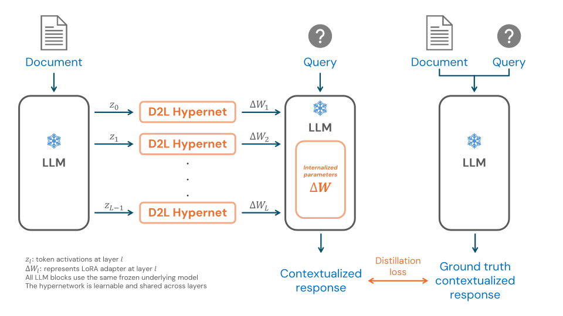

# Doc-to-LoRA: Learning to Instantly Internalize Contexts

> Sakana AI / Minerva University · 2026-02-13 · paper · **支撑·无闭环** · [论文](https://arxiv.org/abs/2602.15902) · [仓库](https://github.com/SakanaAI/doc-to-lora)
> 机制族：支撑性适应机制 · 来源核验 2026-09-13 · 复现状态 not-run

## Pipeline

元训练后的超网络将文档激活映射为 LoRA 权重；师生蒸馏提供训练反馈，部署时复用适配器回答后续问题，无需重读文档或逐文档计算梯度。

*图源：Overview figure*
## 结果（作者报告，非本地复现）

在 2WikiMultihopQA 上，迭代式 D2L 报告归一化 ROUGE-L 为 0.844、额外更新显存 3.791 GB、延迟 0.551 秒；使用真实问题的理想上下文蒸馏分别为 0.901、7.820 GB、40.171 秒。归一化表现以携带上下文推理为参照。

## 证据边界

这是摊销更新成本的适应机制，而非递归循环；部署不会改进超网络本身，准确率和适配器容量仍构成限制。

## 对 nanoRSI 的输入

建议：后续探索版本化文档适配器作为记忆后端，并与检索方案比较事实保留能力。

## 来源

[Original paper date](https://arxiv.org/abs/2602.15902) · [Paper Table 1](https://arxiv.org/html/2602.15902v1) · [Official project and affiliations](https://pub.sakana.ai/doc-to-lora/) · [Official code](https://github.com/SakanaAI/doc-to-lora) · [Official checkpoint inventory](https://huggingface.co/SakanaAI/doc-to-lora/tree/main)
