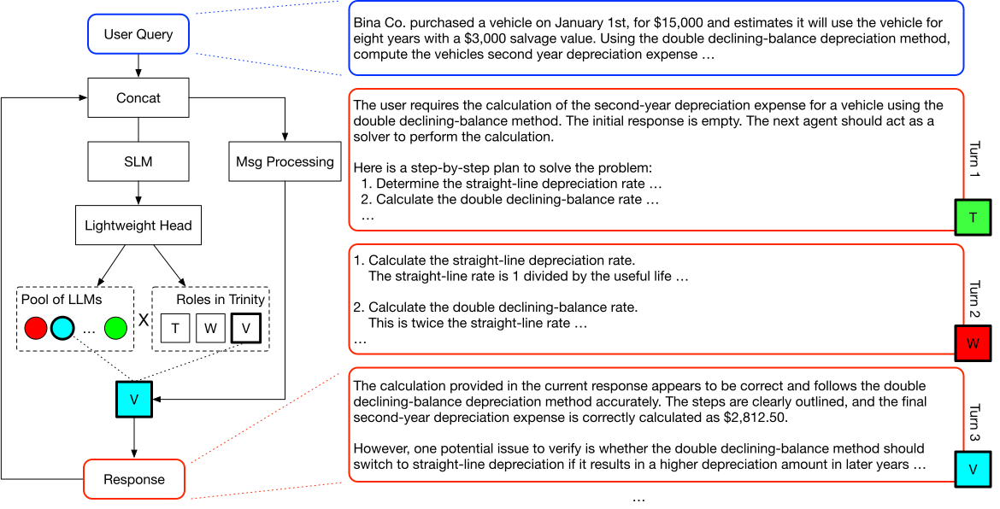

# TRINITY: An Evolved LLM Coordinator

> Sakana AI / Institute of Science Tokyo / University of Michigan · 2025-12-04 · paper · **支撑·无闭环** · [论文](https://arxiv.org/abs/2512.04695)
> 机制族：支撑性适应机制 · 来源核验 2026-09-13 · 复现状态 not-run

## Pipeline

Sep-CMA-ES 扰动小型协调器头，以任务终局结果评分并重组候选参数；保留的协调器反复选择模型及思考者、执行者或验证者角色，底层基础模型权重保持固定。

*图源：Figure 1*
## 结果（作者报告，非本地复现）

LiveCodeBench v6 上，取消输出长度限制且不重新训练协调器时，pass@1 为 86.2%，GPT-5 为 83.8%。另一个每次 4,096 token、最多五轮的对照设置下得分为 61%，不可混用两种条件。

## 证据边界

这是在人类选择的基准上离线优化协调策略，未展示部署后的智能体修改自身学习算法。

## 对 nanoRSI 的输入

建议：在相同 token 预算下比较小型可进化角色/模型路由器与静态路由。

## 来源

[Original paper date](https://arxiv.org/abs/2512.04695) · [Original paper methods and experimental conditions](https://arxiv.org/html/2512.04695v1) · [Official Sakana announcement](https://sakana.ai/trinity/)
