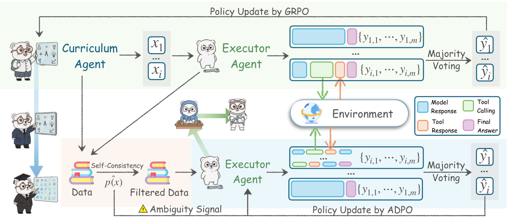

# Agent0: Unleashing Self-Evolving Agents from Zero Data via Tool-Integrated Reasoning

> UNC-Chapel Hill / Salesforce Research / Stanford University · 2025-11-20 · paper · **闭环** · [论文](https://arxiv.org/abs/2511.16043) · [仓库](https://github.com/aiming-lab/Agent0)
> 机制族：自博弈与课程任务生成 · 来源核验 2026-09-13 · 复现状态 not-run

## Pipeline

课程策略面向使用工具的执行器生成任务；十次执行器回答估计不确定性并产生伪标签，筛选任务用于训练执行器，新能力再改变下一轮课程，两种策略迭代更新。

*图源：Figure 2*
## 结果（作者报告，非本地复现）

Qwen3-8B 数学平均分从 49.2 升至 58.2（增加 9.0 个百分点，约相对提高 18%），仅加工具为 53.2。七个数学基准除 AMC/AIME 使用 mean@32 外均为贪心 pass@1；表 1 报告训练过程峰值。

## 证据边界

零数据指不使用人工整理的训练集，并不代表没有预训练知识；自一致性可能强化错误，结果不证明无界改进。

## 对 nanoRSI 的输入

建议：先用不可修改的答案验证器检验难度自适应任务生成，再考虑昂贵的策略训练。

## 来源

[Paper dates](https://arxiv.org/abs/2511.16043) · [Original paper and numerical tables](https://arxiv.org/html/2511.16043v1) · [Official series repository and release date](https://github.com/aiming-lab/Agent0) · [Agent0 training implementation](https://github.com/aiming-lab/Agent0/blob/main/Agent0/README.md)
