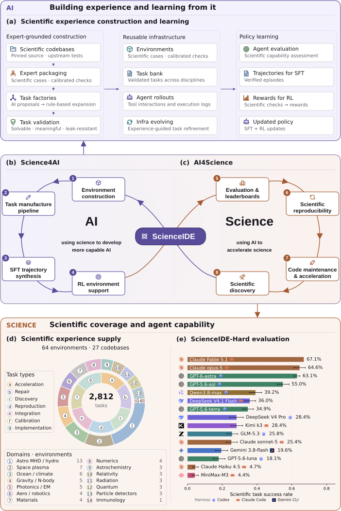

# ScienceIDE: Turning World's Scientific Codebase into Agent Learnable Environments

> PhAI Labs / AItonomy Foundation / Qwen (Alibaba) / University of Oxford / Princeton University 等 · 2026-09-16 · paper · **支撑·无闭环** · [论文](https://arxiv.org/abs/2609.19134) · [仓库](https://github.com/aitofound/ScienceIDE)
> 机制族：自主训练智能体与数据管线 · 来源核验 2026-09-18 · 复现状态 not-run

## Pipeline

把科学代码仓库转换为可编程智能体环境：专家定义的案例与验收准则驱动任务生成、执行与校验；经过验证的交互轨迹作为统一底座供 SFT、RL 与评测使用。

*图源：Figure 1 (scienceide_summary.svg)*
## 结果（作者报告，非本地复现）

用验证轨迹训练 PhAI-IDE-72B/9B/4B；模型族在留出科学代码修复与若干通用代码/推理/知识基准上报告增益（摘要层面为定性描述、无单一头条数字），并报告在线验证者反馈显著改善留出科学奖励。

## 证据边界

作者自报；本次仅核验到摘要层面；增益被表述为科学经验的正迁移，不是受测的自改进循环。

## 对 nanoRSI 的输入

验收准则先行的做法可映射到 nanoRSI 的 fixture：从语料生成可执行的任务+验证器对，仅让验证过的轨迹进入改进循环。

## 来源

[arXiv abstract](https://arxiv.org/abs/2609.19134) · [Paper HTML (author block, Figure 1)](https://arxiv.org/html/2609.19134v1) · [ScienceIDE repository](https://github.com/aitofound/ScienceIDE)
