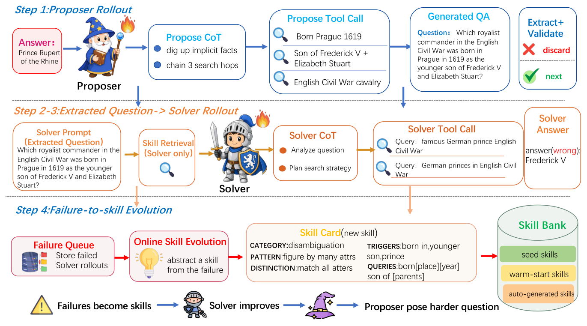

# Self-Play Meets Skill Evolution: Self-Evolving Search Agents that Pose, Solve, and Remember

> University of Chinese Academy of Sciences / Institute of Automation, CAS / Peking University / Mininglamp Technology / Tsinghua University 等 · 2026-07-31 · paper · **闭环** · [论文](https://arxiv.org/abs/2607.29468)
> 机制族：自博弈与课程任务生成 · 来源核验 2026-09-16 · 复现状态 not-run

## Pipeline

非对称自博弈耦合三个进化对象：挑战者从 5 万答案池提出可验证的搜索问题；只有求解者能检索技能库（记忆对挑战者隐藏以防策略泄漏）； informative 的前沿失败被蒸馏为技能（触发条件、规避线索、查询模板），余弦去重并按净负贡献逐出。技能进入在线策略 rollout，重塑策略梯度的轨迹分布，使增益内化进求解者权重；变强的求解者又改变挑战者以前沿塑形的难度奖励，新失败再重写记忆——只在步边界提交库更新的闭环飞轮。

*图源：Figure 2*
## 结果（作者报告，非本地复现）

七个 QA 基准（3,125 道留出题）：六个骨干上比 SSP 平均 +1.2~+3.2（如 Qwen3-8B 均值 47.5、超基线 +7.0）；统一协议下 51.0 对 SkillRL-Search-7B 的 50.1；免记忆部署（SESA-Off）保留 +1.8~+2.2，重新启用技能库再加 +0.5~+1.0。消融：去失败蒸馏 -2.7。

## 证据边界

增益非逐基准均匀（Qwen3-4B 在 2Wiki、Qwen3-8B 在 Bamboogle 低于 SSP）；检索可能干扰求解者；耦合进化证据为相关性；仅求解者可访记忆是设计约束而非消融项。

## 对 nanoRSI 的输入

对 nanoRSI：对任务生成器隐藏进化中的记忆（非对称访问），使生成任务无法利用记忆答案；并在宣布递归前把技能增益内化进权重。

## 来源

[arXiv abstract](https://arxiv.org/abs/2607.29468) · [Paper v1 (affiliations, Figure 2, tables)](https://arxiv.org/html/2607.29468v1)
