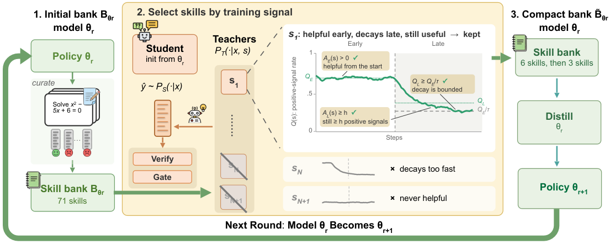

# Which Skill to Distill? SGUID: Selecting a Compact Skill Bank for Model-Skill Co-Evolution

> New York University / Amazon · 2026-10-08 · paper · **闭环** · [论文](https://arxiv.org/abs/2610.12367)
> 机制族：技能-权重共进化 · 来源核验 2026-10-14 · 复现状态 not-run

## Pipeline

每轮协同演化先从当前策略经验证器检查的 rollout 中策展候选技能库，带全库跑一次蒸馏并记录逐技能训练动态信号，只保留早期贡献为正、后期正信号不少于 h、贡献衰减率被 tau 界住的技能，再从本轮基础权重重启、只蒸馏精选小库；更新后策略的 rollout 为下一轮库供种。选择是稳定器：不过滤的技能更新会伤模型。

*图源：Figure 1 (sguid_overview_cropped.png): overview of SGUID at co-evolution round r - curate, select, internalize*
## 结果（作者报告，非本地复现）

6,400 次检索日志中，少于 25% 的被检索技能产生有用蒸馏信号（Qwen3-1.7B 21.2%、Qwen3-4B 19.7%、Qwen3-8B 6.4%）。蒸馏 6 条精选技能在 4 个模型中的 3 个上（Olmo-3-7B、Qwen3-1.7B/4B/8B，AIME24/AIME25/HMMT25）追平或超过全库蒸馏（库最多大 11 倍），第二轮加选 3 条后在全部 4 个模型上成立（Qwen3-8B 64.3→66.3）。过滤决定稳定性：Qwen3-4B 上未过滤的技能更新损失 -0.3 HMMT25，SGUID 逐轮 +0.5、+1.1。

## 证据边界

只测了单轮数学推理；技能只作为训练期条件考察、未作推理期补丁（训练-测试失配留作开放问题）；训练与推理都有用的技能协同演化是未来工作；代码尚未发布（计划录用后放出），精选库列于附录 B。

## 对 nanoRSI 的输入

逐技能效用日志可在 nanoRSI 技能轨落地为审计：给每次闸门决定标注当时上下文中的技能，统计各技能与接受/拒绝候选的共现频率。<25% 活跃率的发现预示库中多数技能是惰性的；该测量可在选择器研究（ADOPTION 38-39 项）之前先给修剪策略提供依据，并与 audit 命令的静默旁路检查相呼应。

## 来源

[arXiv abstract](https://arxiv.org/abs/2610.12367) · [arXiv HTML v1](https://arxiv.org/html/2610.12367v1)
