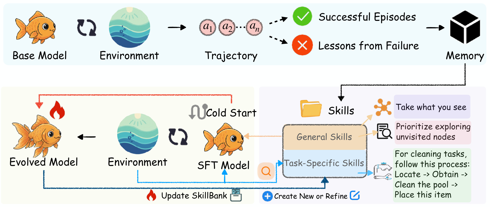

# SkillRL: Evolving Agents via Recursive Skill-Augmented Reinforcement Learning

> University of North Carolina at Chapel Hill / University of Chicago / UC San Diego / NEC Labs America / UC Berkeley 等 · 2026-02-09 · paper · **闭环** · [论文](https://arxiv.org/abs/2602.08234) · [仓库](https://github.com/aiming-lab/SkillRL)
> 机制族：技能-权重共进化 · 来源核验 2026-09-16 · 复现状态 not-run

## Pipeline

从轨迹蒸馏出分层 SkillBank（通用策略 + 按嵌入相似度检索的任务技能），在 rollout 中以上下文形式使用，同时用 GRPO 训练策略——技能库本身持续共进化：每个验证 epoch 后，失败轨迹类别触发技能生成/精炼（每轮最多 3 个新技能），技能与权重互相成就。技能蒸馏压缩上下文 10-20 倍。

*图源：Figure 2*
## 结果（作者报告，非本地复现）

ALFWorld 总成功率 89.9% 对 GRPO 77.6%（绝对 +12.3；Mem0+GRPO 54.7%）；WebShop 85.2 分/72.7% 成功率对 GRPO 79.3/66.1；搜索增强 QA 均值 47.1% 对 Search-R1 38.5%、EvolveR 43.1%（Bamboogle 73.8 对 54.4）。消融：去掉技能库 ALFWorld 掉到 61.7；去掉动态进化掉到 84.4；库从 55 长到 100 个技能。

## 证据边界

无专门局限性章节。隐含：蒸馏依赖强教师（OpenAI o3）、二元奖励、技能增长受超参上限约束、基座为 Qwen2.5-7B-Instruct。

## 对 nanoRSI 的输入

对 nanoRSI：这是技能轨与模型轨之间缺失的桥梁——先让技能对照冻结 rollout 基线验证，再让库与学习器共进化，并记录两侧各自贡献。

## 来源

[arXiv abstract](https://arxiv.org/abs/2602.08234) · [Paper v1 (affiliations, Figure 2, Tables 1-5)](https://arxiv.org/html/2602.08234v1) · [Code repository (MIT)](https://github.com/aiming-lab/SkillRL)
