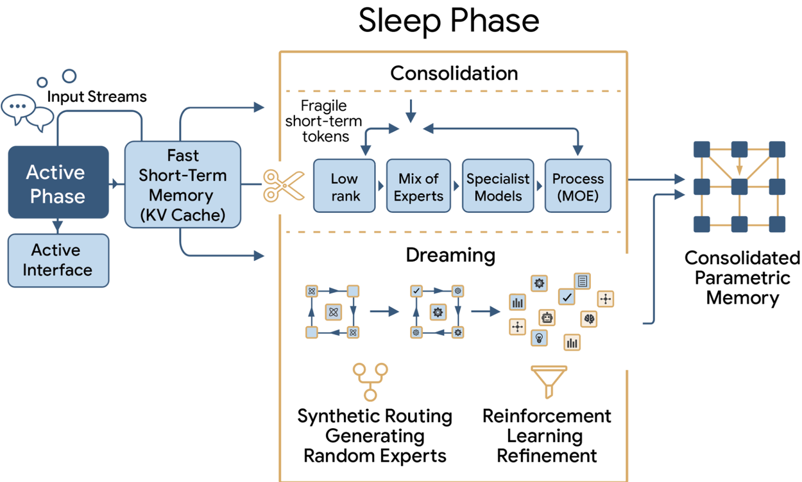

# Language Models Need Sleep: Learning to Self-Modify and Consolidate Memories

> Google / Cornell · 2026-06-02（v2 2026-07-10，官方博客 2026-10-27） · paper · **闭环** · [论文](https://arxiv.org/abs/2606.03979)
> 机制族：经验蒸馏与测试时适应（手写深记） · 来源核验 2026-11-01 · 复现状态 not-run（未核验到官方代码/权重/数据包）

## Pipeline

Sleep 把部署后的模型学习拆成两个交替循环。**Wake**：模型在线执行任务，把交互写进一个有容量上限的短期上下文/情景记忆。**Sleep**：离线阶段把短期记忆巩固进**预分配的参数记忆**——预训练时不激活的 MoE 专家或低秩块——用三种信号训练：对高能力教师的 on-policy 蒸馏（保旧能力）、对自身过去状态的 RL imitation（防漂移）、以及**自生成的 dreaming**（模型合成假想任务与解来自我练习，由难度与学习信号筛选）。自我改进体现在两个机制上：dreaming 样本由模型自己生成并按可学习性筛选；专家/记忆块的梯度贡献被显式筛选与缩放，决定哪些记忆被写入、哪些被遗忘。固定架构与训练规则由人事先定义，模型改的是记忆内容与样本选择。

*图源：Google Research 官方博客框架图（storage.googleapis.com/gweb-research2023-media）*

## 结果（作者报告，非本地复现）

- 数学基准（Qwen3-8B 基座，average@16）：AIME-24 79.2、AIME-25 69.0、HMMT-25 46.1。
- 知识注入：SQuAD 单段 48.9 / 持续预训练 46.2；BABILong 声称可扩展到 10M tokens 上下文。
- 对比基线为不带 sleep 的同架构；官方博客（2026-10-27）补充了 wake/sleep 周期与遗忘-保持曲线。

## 证据边界

论文为 CC BY 4.0，但**未发布官方代码、权重或数据包**——所有数字只能按作者报告对待。架构（记忆块的位置与容量）与训练规则（蒸馏/模仿/dreaming 配比）均为人为设定，论文自述这不是通用自改进；dreaming 样本质量依赖模型自身，存在自我强化的偏置风险。跨任务遗忘的度量只在作者选定的基准上报告。

## 对 nanoRSI 的输入

nanoRSI 的冻结模型 + 可编辑 harness 范式与 Sleep 正交：Sleep 改参数记忆，我们改上下文工件。可移植的是**记账而非机制**——把 wake/sleep 周期数、短期记忆容量、巩固成本（token/时长）、旧能力保持率、dreaming 样本筛选通过率作为账本字段；若未来开权重面，先做"冻结模型 + 冻结评测器下的巩固成本与遗忘曲线"纯测量，不实现权重更新。

## 来源

[arXiv abs 2606.03979](https://arxiv.org/abs/2606.03979) · [官方博客](https://research.google/blog/large-language-models-need-sleep-to-learn/) · [官方框架图](https://storage.googleapis.com/gweb-research2023-media/images/LLMSleep1_Framework.width-1250.png)
