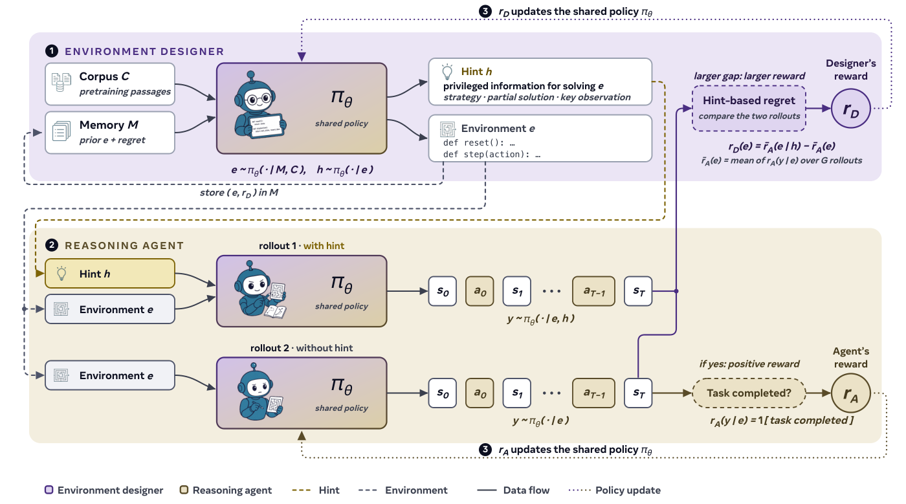

# SPADE: Self-Play in Adaptive Synthetic Executable Environments

> University of Washington / Stanford University / Northeastern University / Carnegie Mellon University / MIT 等 · 2026-08-19 · paper · **闭环** · [论文](https://arxiv.org/abs/2608.19197) · [仓库](https://github.com/spade-rl/spade)
> 机制族：自博弈与课程任务生成 · 来源核验 2026-09-17 · 复现状态 not-run

## Pipeline

同一 LLM 演两角。环境设计者把完整 MDP 写成可执行 Python（Gym 风格 reset/step），锚定在采样的预训练语料文档 + 带后悔分与技能标签的历史环境记忆上，并输出特权提示；推理智能体分别在有/无提示下玩该环境，设计者奖励为基于提示的后悔（回报差，下限为零）混以胜率带 [0.4,0.6] 上的平顶难度锚。带角色优势归一化、延迟设计者更新与非对称裁剪的 GRPO 让环境分布与智能体能力前沿共进化。

*图源：Figure 4*
## 结果（作者报告，非本地复现）

Qwen3-30B-A3B 游戏套件均值：SPADE 58.3 对基线 50.2（+8.1）、固定环境 RLVE 53.0 与 GRPO 51.4（超最强固定环境基线 +5.3）；工具使用均值 +7.7（ACEBench-Agent 75.9 对 62.0）。消融：去记忆 53.2、去语料锚定 53.5、去设计者训练 40.5（低于基线）。语料锚定把环境多样性 Vendi/nn 从 0.04 提到 0.68，物理公式泄露率从 25% 降到 5%。

## 证据边界

作者自述：复杂度受模型规模约束（'看不见的皮带'）；优化器是人工设计的 GRPO（SPADE 不修改自身学习规则）；后悔课程无形式化最优性；在固定基准而非开放增长上评测。

## 对 nanoRSI 的输入

对 nanoRSI：用基于提示的后悔（提示带来多少提升）而非原始难度奖励任务/环境生成器，并让生成环境锚定在检索到的语料文档上，防止多样性塌缩。

## 来源

[arXiv abstract](https://arxiv.org/abs/2608.19197) · [Paper v1 (affiliations, Figure 4, tables)](https://arxiv.org/html/2608.19197v1) · [Code repository (MIT)](https://github.com/spade-rl/spade)
