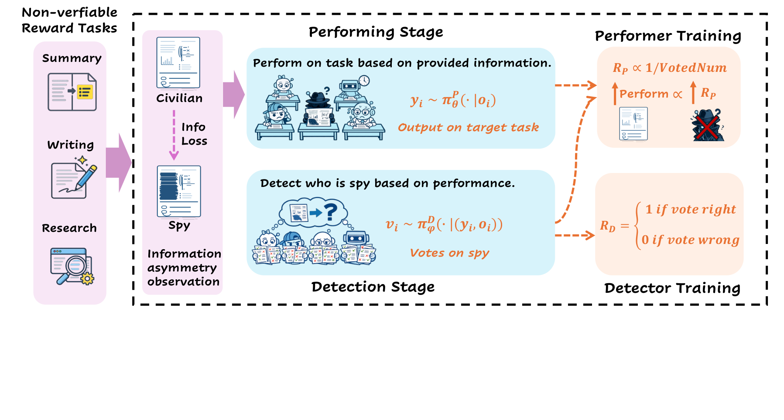

# From RLVR to RLSVR: Task Transformation Induces Self-Verifiable Rewards for Open-Ended LLM Self-Improvement

> Duke University / Adobe Inc. / Pennsylvania State University / National University of Singapore / Oregon State University 等 · 2026-07-26 · paper · **闭环** · [论文](https://arxiv.org/abs/2607.23802) · [仓库](https://github.com/wangqinsi1/RLSVR/tree/SpyRL)
> 机制族：自博弈与课程任务生成 · 来源核验 2026-09-16 · 复现状态 not-run

## Pipeline

把开放式任务变换为'潜变量诱导精确可查奖励'的代理环境：SpyRL（谁是卧底）中 n-1 个平民看完整输入、卧底看降级版，各自作答后检测者投票猜卧底——检测奖励对环境指定的卧底编号确定性可查，表演奖励按怀疑票零和分配。GRPO 式优化配角色优势估计与迟滞门控的交替更新；全程无人类偏好、无 LLM 裁判。

*图源：Figure 2*
## 结果（作者报告，非本地复现）

Qwen3-8B 对骨干胜率：摘要 75.4%、创意写作 77.3%；GovReport ROUGE-L 36.7 对 Absolute Zero 33.2、R-Zero 32.1、基线 30.2；数学同升（Qwen3-4B：GSM8K 93.4 对 84.5、GPQA-D 41.3 对 26.3，平均 +8.97%）；以少约 200-900 美元的验证器推理成本胜过 rubric-as-reward 流水线（Qwen3.5-27B-RaR）。

## 证据边界

数学到写作的跨任务迁移失败（负迁移）；组规模收益 n>5 后饱和；降级算子必须保持有意义且不退化；长期自博弈有已知退化风险，仅缓解未消除。

## 对 nanoRSI 的输入

对 nanoRSI：任务缺验证器时，把它变换为'隐藏状态使奖励机械可查'的代理博弈——用构造获得可验证性，而非靠裁判。

## 来源

[arXiv abstract](https://arxiv.org/abs/2607.23802) · [Paper v2 (affiliations, Figure 2, tables)](https://arxiv.org/html/2607.23802v2) · [Code repository (Apache-2.0)](https://github.com/wangqinsi1/RLSVR/tree/SpyRL)
