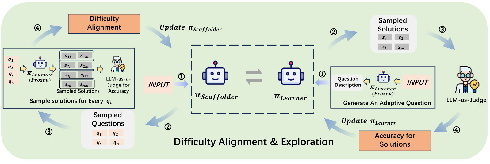

# STRETCH the Boundaries: A Unified Self-Taught Framework for Progressive LLM Evolution

> University of Birmingham · 2026-09-16 · paper · **闭环** · [论文](https://arxiv.org/abs/2609.18642) · [仓库](https://github.com/GuanNiPiShi123/STRETCH)
> 机制族：自博弈与课程任务生成 · 来源核验 2026-09-19 · 复现状态 not-run

## Pipeline

同一模型在同参数空间交替扮演 Scaffolder 与 Learner：GRPO 训练的出题奖励钉在学习者 50% 成功率，把任务保持在拉伸区；epoch 级 Golden Experience Replay（成功题/轨迹对 SFT）稳住双循环。

*图源：Figure 2 (Method_v2_cropped.png)*
## 结果（作者报告，非本地复现）

Qwen2.5-7B-Instruct 在 Mano Complex：67.9 ER / 63.6 SA，对照 R-Zero 64.8/61.7、Absolute Zero 63.4/60.1；Complex OR 58.7/55.0 vs StepORLM 57.3/52.6；六个自博弈 epoch、LoRA rank16、2×H100。

## 证据边界

作者自报，相对 R-Zero/AZR 在运营推理基准上优势不大；判分/模拟器依赖 GPT-4o-mini；代码仓库无 LICENSE 文件。

## 对 nanoRSI 的输入

50% 成功率的奖励峰值可为 nanoRSI 探针任务生成提供可调难度目标——保持半数可解的任务流让每次评估的信息量最大。

## 来源

[arXiv abstract](https://arxiv.org/abs/2609.18642) · [Paper HTML (affiliations, Table 1, Figure 2)](https://arxiv.org/html/2609.18642v1) · [Code repository](https://github.com/GuanNiPiShi123/STRETCH)
