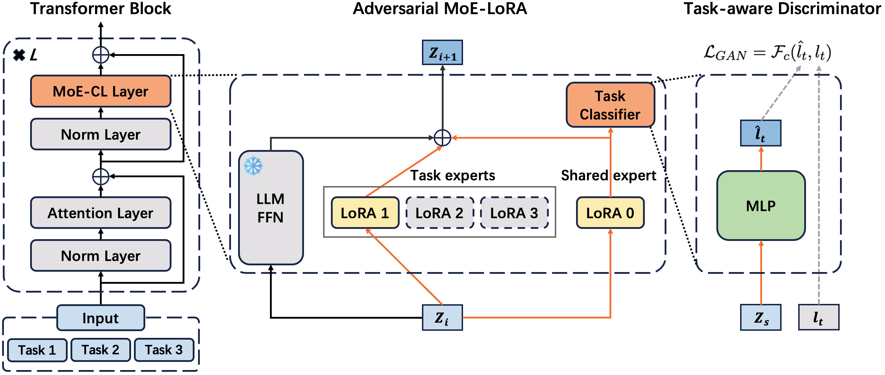

# Self-Evolving LLMs via Continual Instruction Tuning

> Beijing University of Posts and Telecommunications / Tencent AI Lab · 2025-09-14 · paper · **支撑·无闭环** · [论文](https://arxiv.org/abs/2509.18133) · [仓库](https://github.com/BAI-LAB/MoE-CL)
> 机制族：支撑性适应机制 · 来源核验 2026-09-13 · 复现状态 not-run

## Pipeline

连续指令微调更新任务专属与共享 LoRA 专家，任务感知对抗判别器帮助区分可迁移知识及任务特有信息；保留的专家将旧知识带入后续任务。未建立自主任务生成、评测及改进者再训练闭环，因此归为持续学习支撑技术。

*图源：Figure 1*
## 结果（作者报告，非本地复现）

论文评估连续学习及腾讯内容审核应用。此处不保留数值结论：摘要将指标表述为审核成本下降，实验部分则描述离线免审率提升；引用业务效果前需统一口径。

## 证据边界

在外部提供的任务流上保留知识，不证明自主递归改进；工业数据访问限制复现。

## 对 nanoRSI 的输入

拟议 nanoRSI learner 对照：固定外部任务流，保留各任务退化分数，区分持续学习与直接自我改进。

## 来源

[arXiv submission and revision history](https://arxiv.org/abs/2509.18133) · [Paper v1 affiliations and experiments](https://arxiv.org/html/2509.18133v1) · [Author implementation](https://github.com/BAI-LAB/MoE-CL)
