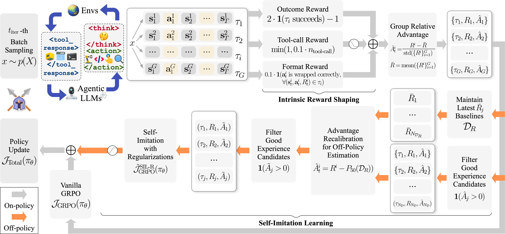

# Learn the Ropes, Then Trust the Wins: Self-imitation with Progressive Exploration for Agentic Reinforcement Learning

> Tencent Youtu Lab / Shanghai Jiao Tong University / Peking University / Fudan University / Xiamen University · 2025-09-26 · paper · **闭环** · [论文](https://arxiv.org/abs/2509.22601) · [仓库](https://github.com/TencentYoutuResearch/SPEAR)
> 机制族：自博弈与课程任务生成 · 来源核验 2026-09-13 · 复现状态 not-run

## Pipeline

SPEAR 将按课程调度工具使用内在奖励的渐进探索，与自模仿回放的利用阶段结合。优势重校准修正回放分布漂移，协方差裁剪和熵控制稳定更新；回放缓冲区跨策略更新复用，形成有界的策略训练闭环。

*图源：Figure 2, overview.png*
## 结果（作者报告，非本地复现）

摘要报告 ALFWorld 相比 GRPO/GiGPO/Dr.BoT 最高提升 +16.1/+5.1/+8.6%，WebShop 最高提升 +20.7/+11.8/+13.9%。在 32K Qwen2.5-32B-Instruct 对照行中，AIME24 从 Dr.BoT 的 67.2 升至 71.0（+3.8），AIME25 从 55.1 升至 61.0（+5.9）。

## 证据边界

收益依赖模型、任务和消融设置：部分行中单独加入自模仿会降低 AIME24。任务流、验证器和奖励设计仍由外部提供，因此这是固定训练框架内的策略改进，不是改进器自主重设计。

## 对 nanoRSI 的输入

在 nanoRSI 学习器实验中公开回放来源：在匹配 rollout 预算下比较均匀采样、冻结回放和递归刷新回放，同时报告隐藏集收益与回放造成的退化。

## 来源

[arXiv first submission and history](https://arxiv.org/abs/2509.22601) · [Paper v1 and overview figure](https://arxiv.org/html/2509.22601v1) · [Tencent YoutuResearch SPEAR repository](https://github.com/TencentYoutuResearch/SPEAR) · [SPEAR custom license terms](https://github.com/TencentYoutuResearch/SPEAR/blob/main/SPEAR_LICENSE.txt)
