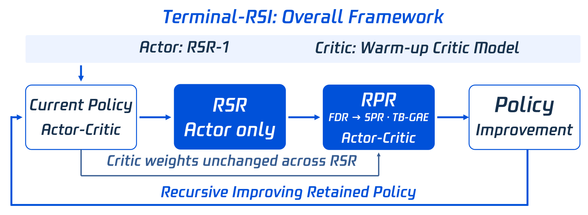

# Terminal-RSI: Recursive Self-Improving Terminal Agents via Recursive Self-Rewrite and Policy-Refine

> Tencent Hy Frontier / National University of Singapore / University of Maryland / University of Georgia / Indiana University · 2026-10-15 · paper · **闭环** · [论文](https://arxiv.org/abs/2610.22192)
> 机制族：经验蒸馏与测试时适应 · 来源核验 2026-10-18 · 复现状态 not-run

## Pipeline

从 Qwen3.8-27B 基座起五个阶段：RSR-1 → RPR-1 → RSR-2 → RPR-2。递归自重写（RSR，仅演员）发现验证通过的轨迹（仅在验证器通过时保留）、用保留演员规划 runbook、经泄漏/审查闸门筛查、在目标 harness 下执行全新重放，并在清洗后的轨迹上做 SFT，critic 权重冻结。递归策略精炼（RPR，演员-critic 联合）跑 PPO，critic 继承上一阶段并先经四步仅 critic 更新重校准；非对称裁剪 [0.30, 5.00]，无 KL 与熵项。回合边界跳观测 GAE 在 token 级基线上加回合级衰减，观测 token 只条件化价值而不作递归节点；家族稠密奖励跨任务族校准语义进展，成功优先奖励把严格成功与有界部分得分分开。

*图源：Figure 2 (terminal_rsi_overall_from_ppt.png), arXiv HTML 2610.22192v1*
## 结果（作者报告，非本地复现）

每个被保留的阶段检查点在全部基准上评测（Mean@3）：Terminal-Bench 4.0 0.00→6.10→16.67→17.46→19.84%；TB-2.1 51.70→86.52%；TB-3.0 0.00→16.95%；TB-Hard 31.00→79.00%；LHTB 过程奖励 0.21→0.37、严格完成 0/46→5/46；SWR100 成功率翻倍 3.00%→6.00%。终阶段外部参照：TB-4.0 19.84% 对 Gemini 3.8 Flash 19.70%、DeepSeek V4 Pro 14.60%；TB-2.1 86.52% 对 GPT-6 Sol 85.40%、Kimi K3 85.00%。含直接 PPO 对照。

## 证据边界

作者自陈局限：无算力对齐的交替实验、TB-GAE 未单独消融、各阶段超参数与阶段效应共变；三次评测运行不等于独立训练种子；检查点选择无受保护验证集；验证覆盖有缺口（Rust-C 案例过模糊测试但在原生架构上失败）；仅一个 27B 基座；SWR100 走平。

## 对 nanoRSI 的输入

权重侧交替超出 nanoRSI 本地预算，但两个协议可直接迁移：每个被保留的中间检查点都在冻结面板与终测上评测（多种子选择器研究应采用的阶梯报告），以及奖励整形中把严格成功与有界部分得分分开（nanoRSI 已有的面板/终测切分）。跨自重写轮次的 critic 继承是数据分布在自我修改下漂移时保持价值估计稳定的已发表模式。

## 来源

[arXiv abs 2610.22192](https://arxiv.org/abs/2610.22192) · [arXiv HTML v1](https://arxiv.org/html/2610.22192v1) · [Terminal-RSI project page](https://jyyang26.github.io/terminal-rsi/)
