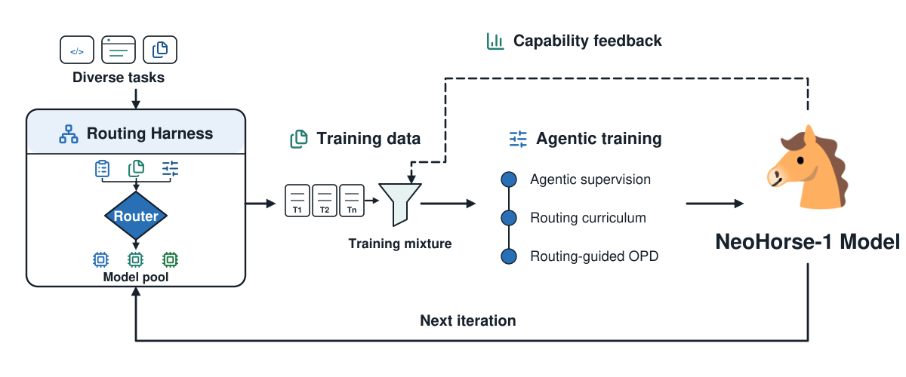

# NeoHorse-1: Towards Recursive Self-Improvement via Agentic Post-Training with Routing Harness

> TokenRhythm Technologies / Infinigence AI / Tsinghua University / Peking University / The Chinese University of Hong Kong 等 · 2026-09-08 · paper · **闭环** · [论文](https://arxiv.org/abs/2609.08183) · [仓库](https://github.com/TokenRhythm/NeoHorse)
> 机制族：自主训练智能体与数据管线 · 来源核验 2026-09-14 · 复现状态 not-run

## Pipeline

由异构模型池支撑的路由 harness 记录真实智能体流量中的能力需求信号；这些记录经结构校验、六维语义打分与子场景标注转为训练样本，路由分数编排三阶段 SFT 课程与路由引导的在线策略蒸馏，能力引导分配再依据评测反馈生成下一轮训练配比；新检查点回到 harness，"闭合评测–选择–更新环"。

*图源：Figure 2*
## 结果（作者报告，非本地复现）

后训练使十个基准（六个智能体、两个代码、两个指令遵循）的宏平均从 4B 的 58.94 升至 64.87，9B 从 65.60 升至 69.04（底座为 Qwen3.5-4B/9B）；后训练后的 4B 明显缩小与未训练 9B 底座的差距。各轨道对照包括 Gemma-4、Granite-4.2、Spark-X2.5 等。

## 证据边界

作者自述这是"对递归自改进的初步尝试而非决定性证明"：结果只覆盖评测–选择–更新环的单次执行，多轮迭代能否持续累积未经验证；验证范围也限于智能体/代码/工具/指令领域能力。

## 对 nanoRSI 的输入

建议：在固定任务流上，以匹配的 token 预算比较能力引导的训练数据分配、均匀采样与冻结数据配比，并记录分配器的选择能否迁移到隐藏任务。

## 来源

[arXiv abstract (v1 date)](https://arxiv.org/abs/2609.08183) · [Paper HTML (loop description, scores, limitations)](https://arxiv.org/html/2609.08183v1) · [Official implementation (Apache-2.0)](https://github.com/TokenRhythm/NeoHorse)
