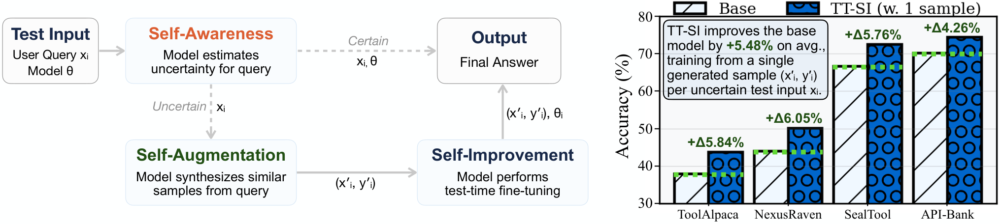

# Self-Improving LLM Agents at Test-Time

> University of Illinois Urbana-Champaign · 2025-10-09 · paper · **闭环** · [论文](https://arxiv.org/abs/2510.07841)
> 机制族：经验蒸馏与测试时适应 · 来源核验 2026-09-16 · 复现状态 not-run

## Pipeline

对每个不确定的测试样本，三阶段自改进全程在推理期完成：自我感知用候选动作 NLL 的相对 softmax 打分标记低边际样本；自我数据增强让模型自己（从不看金标）从被标记样本生成 K 个相似输入-输出对；自我改进在合成数据上做临时 LoRA 微调，用适配后的权重作答，再把参数重置回原值。

*图源：Figure 1*
## 结果（作者报告，非本地复现）

相对提示基线平均绝对 +5.48%（ToolAlpaca +5.84%、NexusRaven +6.05%、SealTool +5.76%、API-Bank +4.26%）；SealTool 上以少 68 倍样本（190 个合成样本对约 1.3 万训练集）超过 SFT（72.43% 对 70.20%）。

## 证据边界

对不确定性阈值敏感（自主学习阈值仍是开放问题）；受基座能力上界约束——预训练中没有的知识无法恢复；小样本训练方差大（五个种子取平均）。

## 对 nanoRSI 的输入

对 nanoRSI：最小逐样本环——不确定性触发的合成自数据 + 临时适配器、答完即重置——可在数字/工件任务上验证，无需训练基础设施。

## 来源

[arXiv abstract](https://arxiv.org/abs/2510.07841) · [Paper v1 (affiliations, Figure 1, per-benchmark gains)](https://arxiv.org/html/2510.07841v1)
