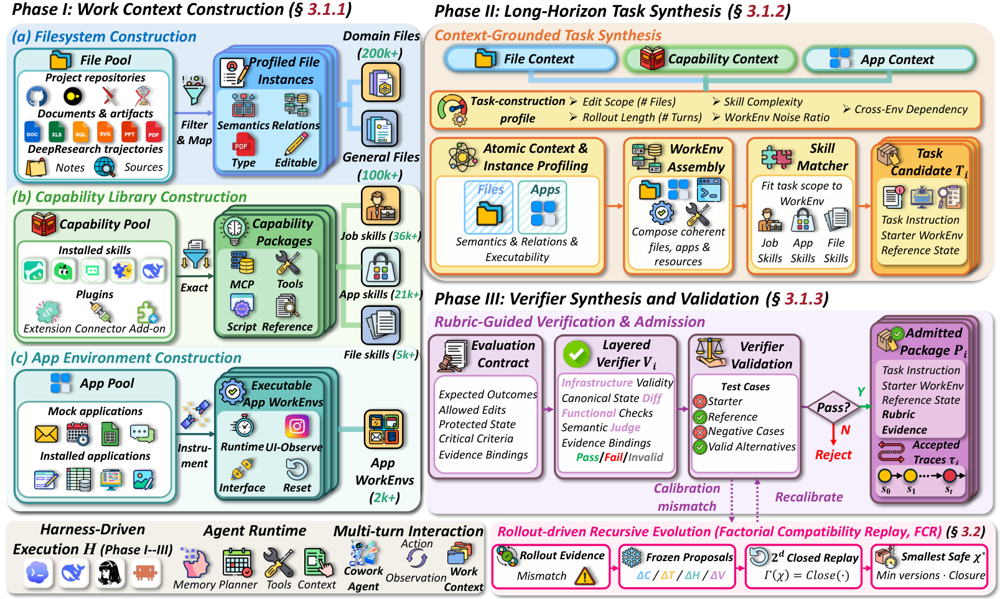

# WorkRover: Scaling Long-Horizon Cowork Agent Training Via Recursive Environment Evolution

> Fudan University / East China Normal University / Renmin University of China / Shanghai Qiji Zhifeng / Shanghai Innovation Institute · 2026-10-13 · paper · **闭环** · [论文](https://arxiv.org/abs/2610.18067)
> 机制族：自主训练智能体与数据管线 · 来源核验 2026-10-16 · 复现状态 not-run

## Pipeline

把环境视作 N 个 <Context, Task, Verifier> 任务包，由自适应的构建代理建造与修复而非固定流水线。阶段一打包工作上下文（仓库文件、DeepResearch 轨迹、MCP 接口技能、插桩应用）；阶段二由 Skill Matcher 组装 WorkEnv，独立的 Demonstrator Agent 从起始工作区执行以确认可行性并产出 Reference State，其差异即完成证据；阶段三从指令派生冻结的 Evaluation Contract（基础设施有效性、规范状态差异、功能检查、语义判官），并以“拒收起始态与突变体、接受参照与有效替代”校准。递归演化：rollout 暴露缺陷时，诊断先区分代理错误与环境问题；每个合格组件一份冻结修复提案（d≤4、≤16 组合），扩展为依赖闭更新集 Γ(χ)=Close(χ)；重建包在匹配种子/策略下重放，选取最小通过验证的闭编辑集，回归检查与新种子确认后才晋升。训练上，Verifier-to-Turn 信用分配增广轨迹 GRPO 优势——冻结的确定性检查为回合间工作区进展打分，每个正增量的至少一半留在产出回合，其余按“工具输出或精确工件版本被直接使用”的依赖记给前置回合，负增量留在本地。

*图源：Figure 3 (S3.F3), arXiv HTML v1*
## 结果（作者报告，非本地复现）

对 Qwen3.5-35B-A3B 后训练（SFT 30,115 条轨迹来自 Qwen3.5-397B-A17B；RL 3,200 对来自 20,000 筛选候选）得到 WorkRover-35B-A3B：JobBench 10.62→36.89%（+26.27）、OfficeQA Pro 19.55→48.87%（+29.32）、GDPval v2 804.75→1218.00 Elo（+413.25）、AutomationBench +22.67、WorkBuddy Office +13.63；在全部五项上领先 27–35B 开源同侪（Occamy-1.0 次之），部分落后 Kimi K3、>400B 开源模型与 GPT-5.5 / Claude Opus 4.7。FCR 消融：自然缺陷 Safe Resolution Rate 60.7%→70.3% 对全量重生成、任务意图变更 14.3%→1.3%、合成通过率 49.8%→74.8%、对 Apply-all 回归 7.0%→0.7%。VTCA 在全部五项上胜过仅回合级 GRPO（最大 AutomationBench +5.7、GDPval +43 Elo）。

## 证据边界

作者声明 FCR 的有界枚举不对全部修复建立全局最小；VTCA 依赖检查器覆盖与依赖记录（出处错误会错配信用、漏记链接使前置回合无信用），且检查器增量的守恒既不保证策略不变性、也不是无偏策略梯度估计。跨模型比较沿用各源自评测设置（未完全对齐）。FCR 的修复可靠性比 Apply-all 花更多 token（相对 1.00 对 0.59）。交接案例研究缺视觉审查。

## 对 nanoRSI 的输入

FCR 即可迁移点：对环境/评测器缺陷，每组件限一份冻结修复、小界枚举，扩展到依赖闭更新集，匹配种子重放后晋升最小通过验证的闭编辑——直接适用于 nanoRSI 任务包生成（prepare.py manifest），坏 fixture 应最小修复而非重生成。以拒绝做校准（起始态与突变体必须失败、参照与有效替代必须通过）是任何 run 之前的评测器自检具体做法。

## 来源

[arXiv abstract](https://arxiv.org/abs/2610.18067) · [arXiv HTML v1](https://arxiv.org/html/2610.18067v1) · [WorkRover project page](https://workrover.github.io/)
