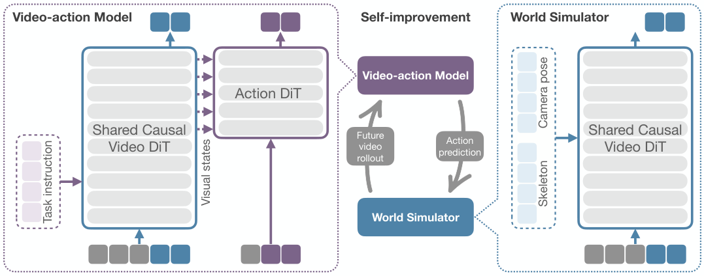

# XPACE: Joint World and Action Modeling from Heterogeneous Experience

> XPENG Robotics · 2026-09-15 · paper · **闭环** · [论文](https://arxiv.org/abs/2609.17372)
> 机制族：自主训练智能体与数据管线 · 来源核验 2026-09-19 · 复现状态 not-run

## Pipeline

共享视频 backbone 联合训练策略与世界模拟器；经 self-gradient-forcing 适配后，模拟器在专家演示周围渲染偏离-恢复轨迹，过滤后用于 DAgger 式策略精调——在异构经验金字塔上形成世界模型驱动的自改进闭环。

*图源：Figure 4 (model_v3.png)*
## 结果（作者报告，非本地复现）

真机 3 任务 × 20 试验：平均成功率 68.3%、进度 0.84，对照 DreamZero 40.0%/0.68、GR00T 6.7%/0.36；自改进闭环把平均成功率 61.7%→86.7%、进度 0.81→0.93（倒茶 50%→95%）。

## 证据边界

作者自报于三个真机操作任务；未找到代码或权重发布；闭环依赖保真度尚可的预训练世界模型。

## 对 nanoRSI 的输入

偏离-恢复配方是一种免环境数据生成器：重放已记录的 nanoRSI 候选轨迹，在接受解附近施加扰动，保留成功恢复的修复——不跑新环境就得到合成负例。

## 来源

[arXiv abstract](https://arxiv.org/abs/2609.17372) · [Paper HTML (Figure 4/12, results)](https://arxiv.org/html/2609.17372v1)
